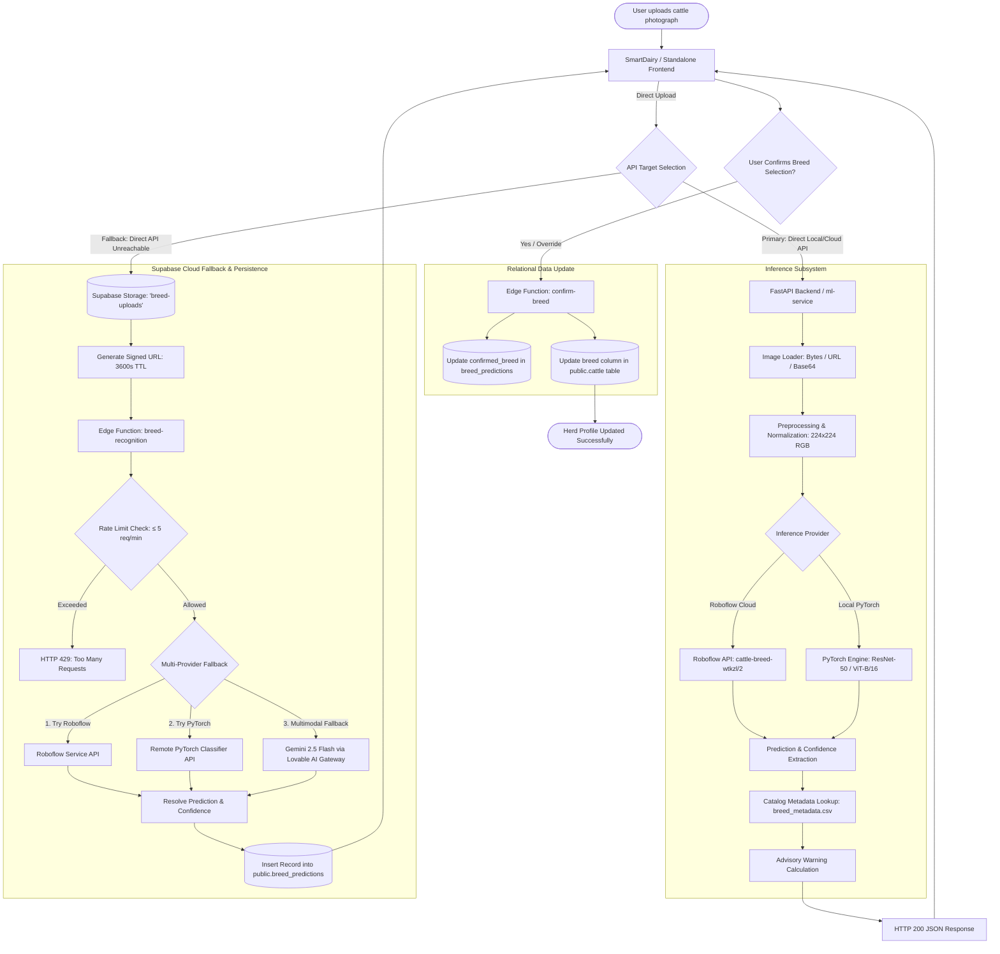

# Cattle Breed Recognition — Comprehensive System Documentation

> **File:** `breed.md`
> **Repository:** SmartDairy / Cattle Breed Classifier WebApp
> **Documentation Scope:** End-to-end documentation of the deep learning cattle and buffalo breed recognition system, dataset, model architectures, benchmark experiments, inference pipelines, backend microservices, REST APIs, frontend integration, and database persistence layers.
> **Source Verification:** All metrics, code references, schemas, and configurations are verified against the actual repository codebase, notebooks, YAML configs, manifests, evaluation JSON reports, and migration files.

---

## Table of Contents
1. [Cattle Breed Recognition — Complete Overview](#1-cattle-breed-recognition--complete-overview)
2. [Repository Architecture](#2-repository-architecture)
3. [Dataset](#3-dataset)
4. [Breed Classes](#4-breed-classes)
5. [Data Preprocessing Pipeline](#5-data-preprocessing-pipeline)
6. [Models Investigated](#6-models-investigated)
7. [Model Experiment Comparison](#7-model-experiment-comparison)
8. [Final / Best Model](#8-final--best-model)
9. [Model Training Pipeline](#9-model-training-pipeline)
10. [Model Evaluation](#10-model-evaluation)
11. [Inference Pipeline](#11-inference-pipeline)
12. [Backend API](#12-backend-api)
13. [Backend Schemas](#13-backend-schemas)
14. [Backend Services](#14-backend-services)
15. [Configuration & Environment](#15-configuration--environment)
16. [Artifacts and Output Files](#16-artifacts-and-output-files)
17. [Frontend Integration](#17-frontend-integration)
18. [Database & Storage Integration](#18-database--storage-integration)
19. [Complete Data Flow Diagram](#19-complete-data-flow)

---

# 1. Cattle Breed Recognition — Complete Overview

### What the System Does
The Cattle Breed Recognition System is a computer vision and deep learning solution designed to identify and classify indigenous Indian cattle (*Bos indicus*) and riverine buffalo (*Bubalus bubalis*) breeds from standard digital photographs. Identifying indigenous Indian livestock breeds typically requires specialized bovine morphological knowledge that dairy farmers, extension workers, and livestock registrars may lack. The system automates this identification by processing uploaded images through trained neural networks and returning the predicted breed alongside confidence metrics and biological metadata.

### Main Objective
1. **Accurate Breed Identification:** Differentiate between 26 distinct indigenous breeds (20 cattle breeds and 6 buffalo breeds) that often share subtle morphological similarities (e.g., lyre-shaped horns, coat colorations, pendulous ears, dewlap structures).
2. **Biodiversity & Genetic Preservation:** Support conservation of native germplasm by accurately identifying indigenous stock versus nondescript or crossbred animals.
3. **Productivity & Farm Management:** Provide dairy farmers with immediate access to breed-specific performance benchmarks (average daily milk yield in liters, expected lifespan, draught suitability, regional climate resilience).
4. **Automated Livestock Onboarding:** Enable rapid cattle registration into digital herd-management systems (such as the SmartDairy platform) by linking photo predictions directly to cattle asset records.

### Input
- **Image Formats:** RGB images in formats JPEG (`.jpg`, `.jpeg`), PNG (`.png`), WebP (`.webp`), BMP (`.bmp`), or JFIF (`.jfif`).
- **Input Channels:** 3 color channels (auto-converted to RGB via PIL).
- **Ingestion Mechanisms:** Multipart file upload (`multipart/form-data`), remote public/signed image URL (`application/json`), or Base64-encoded image string (`application/json`).
- **Image Requirements:** Max file size of 10 MB. Recommended input is an unobstructed, side-profile (lateral) photograph of the standing animal showing body proportions, head profile, horn morphology, and dewlap.

### Output
- **Primary Prediction:** Predicted breed name (e.g., `"Gir Cow"`, `"Banni Buffalo"`).
- **Confidence Score:** Decimal probability between `0.0000` and `1.0000` (PyTorch standalone API) or normalized percentage `0.0%` to `100.0%` (SmartDairy API).
- **Top-K Rankings:** Sorted list of the top $K$ most probable breeds with their corresponding confidence scores (default $K=3$).
- **Biological Metadata:** Associated breed catalog information retrieved from `breed_metadata.csv`, including:
  - Animal type (`Cow` or `Buffalo`)
  - Native origin/region (e.g., `"Gujarat, India"`, `"Tamil Nadu, India"`)
  - Average daily milk yield (`avg_milk_liters_per_day`)
  - Expected lifespan (`lifespan_years`)
  - Primary agricultural utilization (`Dairy`, `Draught`, `Dual Purpose`)
  - Morphological description, coat color characteristics, and horn structure
  - Official source reference (ICAR-NBAGR India)
- **Inference Diagnostics:** Model version string, execution latency in milliseconds (`inference_time_ms`), and dynamic confidence warning flags when prediction uncertainty exceeds predefined thresholds.

### Where the AI Model Is Used
The AI model operates across two distinct subsystems in the repository:
1. **Standalone Cattle Breed Classifier Web Application (`cattle-breed-classifier-webapp-master`):**
   - Contains the complete research, training, and standalone serving pipeline.
   - Houses PyTorch deep learning models (MLP, custom CNN, ResNet-50, ViT-B/16).
   - Serves local predictions via FastAPI (`backend/app/main.py`) and is deployed to Hugging Face Spaces (`sajit9285/cattle-breed-classifier`) using a unified Docker container.
2. **Integrated SmartDairy Platform (`cow-care-chronicles-main`):**
   - Houses a dedicated microservice (`ml-service/main.py`) that integrates both the Roboflow Serverless Inference API (hosted model `cattle-breed-wtkzl/2`) and local PyTorch model inference.
   - Connects to the SmartDairy Vite/React frontend (`src/pages/BreedRecognition.tsx`).
   - Integrates with Supabase Edge Functions (`supabase/functions/breed-recognition/index.ts` and `confirm-breed/index.ts`), with fallback to multimodal Google Gemini 2.5 Flash vision via Lovable AI Gateway.

### Current Implementation Status
| Subsystem Component | Implementation Status | Repository Details |
|---|---|---|
| **Raw Dataset** | Fully Available | 3,056 resized 256x256 images in `Cattle_Resized/` across 26 class directories. |
| **Data Manifests** | Fully Generated | Stratified splits (70/15/15) stored in `ml/artifacts/manifests/` (`all.csv`, `train.csv`, `val.csv`, `test.csv`). |
| **Model Architectures** | Fully Implemented | Modular PyTorch definitions for MLP, 5-block CNN, ResNet-50, and ViT-B/16 in `ml/src/models/`. |
| **Training Pipeline** | Fully Implemented | Unified trainer, early stopping, learning rate schedulers, and metrics logging in `ml/src/training/`. |
| **Jupyter Notebooks** | Fully Implemented | 6 programmatic notebooks (`00` to `05`) and automated Google Colab runner (`colab_run_all.ipynb`). |
| **Evaluation Reports** | Fully Generated | Quantitative metric JSONs, confusion matrices, and training histories in `ml/artifacts/reports/` and `ml/artifacts/logs/`. |
| **Model Weights (`.pth`)** | Externalized / Not in Git | Weight files (`models/*.pth`, `ml/artifacts/checkpoints/*.pth`) are excluded via `.gitignore` to prevent repository bloat; loaded dynamically or downloaded in Colab/Docker. |
| **Standalone Backend** | Fully Implemented | FastAPI server with `/predict/file`, `/predict/url`, `/predict/base64`, `/breeds`, and `/health`. |
| **Standalone Frontend** | Fully Implemented | React 18 SPA in `frontend/` featuring Predictor, Breed Explorer, and Model Benchmark views. |
| **SmartDairy Microservice** | Fully Implemented | FastAPI service in `ml-service/` providing `/api/breed-predict` with Roboflow integration. |
| **SmartDairy Web Client** | Fully Implemented | React/TypeScript page `BreedRecognition.tsx` with direct API upload, Supabase Edge Function fallback, and confirmation flow. |
| **Database & Cloud Storage** | Fully Implemented | Supabase PostgreSQL table `breed_predictions`, Storage bucket `breed-uploads`, and RLS security policies. |

### End-to-End System Flow
```
User selects or captures cattle photograph in Web UI
  │
  ├──► [Client-Side Validation] File type check (.jpg, .png, .webp), size limit (≤ 10MB)
  │
  ├──► [API Dispatch: Path 1 - Direct Microservice]
  │      POST /api/breed-predict (via Vite proxy -> localhost:8000)
  │        │
  │        ├──► Image loaded into memory as raw bytes
  │        ├──► Forwarded to Roboflow Serverless API (cattle-breed-wtkzl/2)
  │        │      OR PyTorch Inference Engine (CattleResNet / CattleViT)
  │        │        ├── Ingestion & RGB conversion (PIL)
  │        │        ├── Resize to 224x224 & Tensor conversion
  │        │        ├── ImageNet Normalization (mean=[0.485, 0.456, 0.406], std=[0.229, 0.224, 0.225])
  │        │        ├── Forward pass -> Softmax logits -> Top-k extraction
  │        │
  │        ├──► Class index mapped to canonical breed name
  │        ├──► Enriched with breed metadata from data/breed_metadata.csv
  │        └──► HTTP 200 JSON Response returned to UI
  │
  └──► [API Dispatch: Path 2 - Supabase Fallback (if Direct API unreachable)]
         │
         ├──► Upload raw image to Supabase Storage bucket 'breed-uploads'
         ├──► Generate time-limited signed URL (3600 seconds)
         ├──► Invoke Edge Function 'breed-recognition'
         │      ├── Try Roboflow inference via signed URL
         │      ├── Try PyTorch service via BREED_CLASSIFIER_API_URL
         │      └── Fallback: Google Gemini 2.5 Flash via Lovable AI Gateway
         ├──► Insert audit record into PostgreSQL 'public.breed_predictions' table
         └──► Return prediction JSON to client
  │
  ▼
[UI Result Presentation]
  ├── Display predicted breed name & confidence progress bar
  ├── Show high/moderate/low confidence advisory warning
  ├── Display breed characteristics card (milk yield, origin, primary use)
  └── User confirms prediction -> invokes 'confirm-breed' Edge Function -> updates 'cattle' table
```

---

# 2. Repository Architecture

### Directory Tree Overview
```
SmartDairy/
├── breed.md                                              # Comprehensive documentation file (this document)
└── cow-care-chronicles-main/
    ├── .env.example                                      # Environment template for frontend & services
    ├── vite.config.ts                                    # Vite configuration with /api reverse-proxy
    ├── src/                                              # SmartDairy Frontend Application (React/TSX)
    │   ├── pages/
    │   │   └── BreedRecognition.tsx                      # Breed recognition UI & confirmation workflow
    │   └── data/
    │       └── breed-catalog.ts                          # Static breed catalog with local breed definitions
    ├── supabase/                                         # Supabase Backend & Database Migrations
    │   ├── migrations/
    │   │   ├── 20260502182151_0fd5ae57...sql             # Defines breed_predictions table & RLS policies
    │   │   └── 20260503174441_3e6ddeb8...sql             # Updates foreign key cascade on cattle_id
    │   └── functions/
    │       ├── breed-recognition/index.ts                # Edge function for multi-provider breed inference
    │       └── confirm-breed/index.ts                    # Edge function for confirming/linking breed to cattle
    ├── ml-service/                                       # SmartDairy Breed Prediction Microservice
    │   ├── main.py                                       # FastAPI microservice entry point (/api/breed-predict)
    │   ├── roboflow_service.py                           # Roboflow Serverless API client
    │   ├── inference.py                                  # PyTorch model loader & inference engine
    │   ├── image_loader.py                               # PIL image decoding utilities (upload, URL, base64)
    │   ├── breed_info.py                                 # Metadata catalog lookup service
    │   ├── requirements.txt                              # Microservice Python dependencies
    │   └── models/                                       # Local model checkpoint target directory
    └── cattle-breed-classifier-webapp-master/            # Deep Learning Research & Standalone Web App
        ├── Dockerfile                                    # Multi-stage production container build
        ├── docker-compose.yml                            # Local container orchestration
        ├── deploy.py                                     # Hugging Face Spaces automated deployer
        ├── colab_run_all.ipynb                           # Automated Google Colab multi-notebook runner
        ├── requirements.txt                              # Root Python dependencies
        ├── backend.log                                   # Execution log from active FastAPI runtime
        ├── Cattle_Resized/                               # Raw image dataset (26 class directories)
        ├── data/
        │   └── breed_metadata.csv                        # NBAGR-verified catalog metadata for 26 breeds
        ├── backend/                                      # Standalone FastAPI Application
        │   ├── Dockerfile                                # Backend-specific container definition
        │   ├── requirements.txt                          # Backend dependencies (fastapi, uvicorn, etc.)
        │   └── app/
        │       ├── main.py                               # FastAPI application factory & SPA static mount
        │       ├── api/routes/
        │       │   ├── health.py                         # Health check (/health) and version (/version)
        │       │   ├── metadata.py                       # Breed catalog listing (/breeds) and detail
        │       │   └── predict.py                        # Prediction endpoints (/file, /url, /base64)
        │       ├── core/
        │       │   ├── config.py                         # Pydantic Settings configuration loader
        │       │   └── logging.py                        # Formatted stream logger setup
        │       ├── schemas/
        │       │   ├── breed.py                          # Pydantic schemas for breed metadata
        │       │   └── predict.py                        # Pydantic schemas for prediction requests/responses
        │       └── services/
        │           ├── breed_info.py                     # In-memory CSV metadata store
        │           ├── image_loader.py                   # Multi-source PIL image loader
        │           └── inference.py                      # PyTorch model singleton & prediction logic
        ├── frontend/                                     # Standalone React 18 / Vite Web Application
        │   ├── package.json                              # Frontend dependencies (React, Lucide, Tailwind)
        │   ├── vite.config.js                            # Frontend build configuration
        │   └── src/
        │       ├── services/api.js                       # API client for backend communication
        │       └── pages/
        │           ├── HomePage.jsx                      # Landing page with hero banner & quick links
        │           ├── PredictPage.jsx                   # Interactive image upload & inference interface
        │           ├── BreedExplorerPage.jsx             # Searchable catalog of 26 indigenous breeds
        │           └── AboutPage.jsx                     # Model architectures & benchmark explanations
        └── ml/                                           # Machine Learning Pipeline & Experiments
            ├── configs/                                  # Declarative YAML Experiment Configurations
            │   ├── base.yaml                             # Global hyperparameters, paths, and augmentation
            │   ├── mlp.yaml                              # MLP baseline configuration
            │   ├── cnn.yaml                              # Custom CNN from scratch configuration
            │   ├── resnet.yaml                           # ResNet-50 transfer learning configuration
            │   └── vit.yaml                              # Vision Transformer (ViT-B/16) configuration
            ├── notebooks/                                # Jupyter Experimentation Notebooks
            │   ├── 00_data_audit.ipynb                   # Dataset verification, class balance, manifests
            │   ├── 01_mlp_baseline.ipynb                 # MLP training and evaluation
            │   ├── 02_cnn_from_scratch.ipynb             # CNN training and evaluation
            │   ├── 03_resnet_transfer_learning.ipynb     # ResNet-50 two-phase transfer learning
            │   ├── 04_vit_transfer_learning.ipynb        # ViT-B/16 two-phase transfer learning
            │   └── 05_model_comparison.ipynb            # Multi-criteria scoring and comparison charts
            ├── scripts/
            │   └── generate_notebooks.py                 # Programmatic generator for all 6 notebooks
            ├── src/                                      # Modular Machine Learning Source Code
            │   ├── data/
            │   │   ├── breed_metadata.py                 # Metadata loading & helper abstractions
            │   │   ├── prepare_dataset.py                # Image validation, stratified split, manifest writer
            │   │   └── transforms.py                     # Torchvision augmentation & normalization pipelines
            │   ├── models/
            │   │   ├── mlp.py                            # CattleMLP architecture
            │   │   ├── cnn.py                            # CattleCNN architecture
            │   │   ├── resnet.py                         # CattleResNet architecture
            │   │   └── vit.py                            # CattleViT architecture
            │   ├── training/
            │   │   ├── callbacks.py                      # EarlyStopping, ModelCheckpoint, MetricLogger
            │   │   ├── engine.py                         # Epoch loops, validation passes, latency tester
            │   │   ├── losses.py                         # CrossEntropyLoss and FocalLoss factory
            │   │   ├── optimizer_factory.py              # Adam, AdamW, SGD, RMSprop builder
            │   │   ├── scheduler_factory.py              # Cosine, Step, Plateau learning rate schedulers
            │   │   └── trainer.py                        # Unified Trainer orchestration engine
            │   ├── evaluation/
            │   │   ├── compare_models.py                 # Weighted composite scoring & radar/bar plots
            │   │   ├── metrics.py                        # Accuracy, Macro/Weighted F1, Precision, Recall
            │   │   └── plots.py                          # Confusion matrix, training curves, F1 bar charts
            │   ├── inference/
            │   │   ├── predictor.py                      # Standalone CattlePredictor class
            │   │   └── preprocess.py                     # Image ingestion and normalization
            │   └── utils/
            │       ├── device.py                         # Auto-detection of CUDA / MPS / CPU
            │       ├── io.py                             # JSON and directory utility functions
            │       ├── manifests.py                      # Manifest CSV loader & DataFrame helpers
            │       └── seed.py                           # Random seed setter for deterministic execution
            └── artifacts/                                # Generated Outputs & Experiment Artifacts
                ├── manifests/                            # Train, validation, test, and all CSV splits
                ├── reports/                              # JSON performance reports & summaries per model
                ├── logs/                                 # Epoch-by-epoch training history JSON logs
                └── figures/                              # Class distribution plots & comparison charts
```

### Component File Responsibilities

#### Backend Services (`cattle-breed-classifier-webapp-master/backend/`)
- `app/main.py`: Creates the FastAPI application instance using `create_app()`, registers CORS middleware, attaches API routers (`health`, `predict`, `metadata`), defines lifespan events (which trigger model and metadata loading at startup), and serves the built production React frontend statically from `frontend/dist`.
- `app/api/routes/predict.py`: Handles prediction requests across three ingestion routes (`/predict/file`, `/predict/url`, `/predict/base64`). Reads input, passes it to the `image_loader`, invokes `inference_service.predict()`, combines the output with metadata from `breed_info_service`, and returns a typed `PredictResponse`.
- `app/api/routes/health.py`: Provides `/health` (checks service status and `inference_service.is_loaded`) and `/version` (returns API version, active model name, model version, and class count).
- `app/api/routes/metadata.py`: Implements `/breeds` (filterable by animal type `Cow`/`Buffalo` and search query) and `/breeds/{breed_name}` (fetches full biological profile).
- `app/core/config.py`: Defines application configuration via Pydantic `BaseSettings`, reading from environment variables or `.env` file (e.g., `MODEL_PATH`, `MODEL_NAME`, `METADATA_PATH`, `CLASSES_PATH`, `IMAGE_SIZE`, `TOP_K`).
- `app/core/logging.py`: Configures standard structured console logging with timestamp, level, and logger name formatting.
- `app/schemas/predict.py`: Defines Pydantic models for prediction: `PredictionItem`, `BreedInfo`, `PredictResponse`, `PredictURLRequest`, `PredictBase64Request`, and `ErrorResponse`.
- `app/schemas/breed.py`: Defines schemas for breed metadata responses: `BreedDetail`, `BreedListItem`, and `BreedsListResponse`.
- `app/services/inference.py`: Implements the `InferenceService` singleton. Loads model weights (supports state dict checkpoints or legacy full modules), manages device placement (`cuda`, `mps`, `cpu`), applies torchvision evaluation transforms, executes the forward pass with `torch.no_grad()`, calculates softmax probabilities, extracts top-k predictions, and appends confidence warning messages.
- `app/services/image_loader.py`: Decodes image payloads from raw multipart bytes, HTTP/HTTPS URLs (with 10-second timeouts and max size validation), or Base64-encoded strings into RGB PIL Images.
- `app/services/breed_info.py`: Implements `BreedInfoService` singleton. Loads `breed_metadata.csv` into memory on startup and exposes dictionary lookup, summary formatting, and case-insensitive search.

#### Machine Learning Subsystem (`cattle-breed-classifier-webapp-master/ml/`)
- `configs/*.yaml`: Declarative YAML configuration files establishing model backbones, optimization parameters, split ratios, and artifact paths.
- `src/data/prepare_dataset.py`: Scans `Cattle_Resized/`, validates image readability using PIL, performs stratified 70/15/15 splitting with scikit-learn, and saves manifest CSVs and `class_balance_report.json`.
- `src/data/transforms.py`: Factory for data augmentation (RandomResizedCrop, RandomHorizontalFlip, RandomRotation, ColorJitter) and ImageNet normalization.
- `src/models/*.py`: Implements PyTorch model classes (`CattleMLP`, `CattleCNN`, `CattleResNet`, `CattleViT`).
- `src/training/trainer.py`: Orchestrates end-to-end training, early stopping, periodic validation, checkpointing, and evaluation.
- `src/evaluation/compare_models.py`: Calculates multi-criteria composite rankings across all trained models and generates radar and bar comparison charts.

#### SmartDairy Integration Layer (`cow-care-chronicles-main/`)
- `ml-service/main.py`: Standalone microservice exposing `/api/breed-predict` for the SmartDairy platform. Integrates with Roboflow and PyTorch.
- `ml-service/roboflow_service.py`: Dispatches base64 image data to the Roboflow Serverless Inference API and parses returned predictions.
- `src/pages/BreedRecognition.tsx`: React frontend view managing file selection, direct microservice calls, Supabase Edge Function fallback, and confirmation linking to cattle records.
- `supabase/functions/breed-recognition/index.ts`: Deno edge function providing multi-tiered prediction (Roboflow -> PyTorch -> Gemini 2.5 Flash).
- `supabase/functions/confirm-breed/index.ts`: Deno edge function saving user confirmations and linking verified breeds to cattle profiles in the database.

---

# 3. Dataset

### Dataset Specifications
- **Dataset Name / Relative Directory:** `Cattle_Resized` (located at `cattle-breed-classifier-webapp-master/Cattle_Resized/`).
- **Total Valid Images:** Exactly **3,056 images** across all 26 classes.
- **Number of Classes:** **26 classes** (comprising 20 distinct cattle breeds and 6 buffalo breeds).
- **Native Image Format:** JPEG format (`.jpg`).
- **Native Dimensions Before Preprocessing:** Uniformly **256 × 256 pixels** across all 3,056 images.
- **Native Color Mode:** 3-channel **RGB** mode across 100% of images.
- **Image Dimensions After Preprocessing:** Resized and cropped to **224 × 224 pixels** (input size for MLP, CNN, ResNet-50, and ViT-B/16).
- **Broken / Corrupt Image Handling:** Implemented in `ml/src/data/prepare_dataset.py:validate_images()`. The script opens every image file and calls `Image.verify()`. If an image cannot be read, it is flagged as corrupt, logged to `reports/corrupt_images.json`, and excluded from training. All 3,056 images in `Cattle_Resized` passed verification without errors.
- **Duplicate Image Handling:** Not found in repository; image selection relies on file system uniqueness.
- **Source & Reference Information:** Data is curated based on officially registered indigenous breeds documented by the **ICAR - National Bureau of Animal Genetic Resources (NBAGR)**, Karnal, Haryana, India.

### Dataset Splits
Splitting is automated by `ml/src/data/prepare_dataset.py` using `sklearn.model_selection.train_test_split` with a fixed random seed of `42` (`stratify=labels`):
- **Train Set:** **2,139 images** (70.0% of total) — stored in `ml/artifacts/manifests/train.csv`
- **Validation Set:** **458 images** (15.0% of total) — stored in `ml/artifacts/manifests/val.csv`
- **Test Set:** **459 images** (15.0% of total) — stored in `ml/artifacts/manifests/test.csv`
- **Combined Manifest:** **3,056 images** (100.0%) — stored in `ml/artifacts/manifests/all.csv`

### Class Distribution & Imbalance
The dataset exhibits natural class imbalance reflecting photographic availability of native livestock:
- **Maximum Samples:** Gir Cow (**250 images**, 8.18% of dataset).
- **Minimum Samples:** Banni Buffalo (**36 images**, 1.18% of dataset) and Kherigarh Cow (**36 images**, 1.18% of dataset).
- **Imbalance Ratio:** **6.94 : 1** between majority and minority classes.
- **Mean Samples Per Class:** **117.5 images** (Train: ~82.3, Val: ~17.6, Test: ~17.6).

### Complete Class Distribution Table
| Breed Class Name | Animal Type | Folder Name in `Cattle_Resized/` | Total Images | Train Split (70%) | Val Split (15%) | Test Split (15%) | % of Dataset |
|---|---|---|---|---|---|---|---|
| **Gir Cow** | Cow | `Gir Cow` | 250 | 175 | 37 | 38 | 8.18% |
| **Sahiwal Cow** | Cow | `Sahiwal Cow` | 240 | 168 | 36 | 36 | 7.85% |
| **Tharparkar Cow** | Cow | `Tharparkar Cow` | 221 | 155 | 33 | 33 | 7.23% |
| **Nagpuri Buffalo** | Buffalo | `Nagpuri Buffalo` | 220 | 154 | 33 | 33 | 7.20% |
| **Hallikar Cow** | Cow | `Hallikar Cow` | 186 | 130 | 28 | 28 | 6.09% |
| **Kankrej Cow** | Cow | `Kankrej Cow` | 178 | 125 | 26 | 27 | 5.82% |
| **Rathi Cow** | Cow | `Rathi Cow` | 148 | 104 | 22 | 22 | 4.84% |
| **Pulikulam Cow** | Cow | `Pulikulam Cow` | 127 | 89 | 19 | 19 | 4.16% |
| **Kangayam Cow** | Cow | `Kangayam Cow` | 116 | 81 | 17 | 18 | 3.80% |
| **Malnad gidda Cow** | Cow | `Malnad gidda Cow` | 107 | 75 | 16 | 16 | 3.50% |
| **Deoni Cow** | Cow | `Deoni Cow` | 103 | 72 | 15 | 16 | 3.37% |
| **Jaffrabadi Buffalo** | Buffalo | `Jaffrabadi Buffalo` | 102 | 71 | 15 | 16 | 3.34% |
| **Mehsana Buffalo** | Buffalo | `Mehsana Buffalo` | 96 | 67 | 14 | 15 | 3.14% |
| **Kasaragod Cow** | Cow | `Kasaragod Cow` | 95 | 67 | 14 | 14 | 3.11% |
| **Amritmahal Cow** | Cow | `Amritmahal Cow` | 95 | 67 | 14 | 14 | 3.11% |
| **Alambadi Cow** | Cow | `Alambadi Cow` | 93 | 65 | 14 | 14 | 3.04% |
| **Nili ravi Buffalo** | Buffalo | `Nili ravi Buffalo` | 92 | 64 | 14 | 14 | 3.01% |
| **Nagori Cow** | Cow | `Nagori Cow` | 89 | 62 | 14 | 13 | 2.91% |
| **Nimari Cow** | Cow | `Nimari Cow` | 87 | 61 | 13 | 13 | 2.85% |
| **Dangi Cow** | Cow | `Dangi Cow` | 84 | 59 | 13 | 12 | 2.75% |
| **Umblachery Cow** | Cow | `Umblachery Cow` | 79 | 55 | 12 | 12 | 2.59% |
| **Bargur Cow** | Cow | `Bargur Cow` | 60 | 42 | 9 | 9 | 1.96% |
| **Shurti Buffalo** | Buffalo | `Shurti Buffalo` | 60 | 42 | 9 | 9 | 1.96% |
| **Kenkatha Cow** | Cow | `Kenkatha Cow` | 56 | 39 | 9 | 8 | 1.83% |
| **Kherigarh Cow** | Cow | `Kherigarh Cow` | 36 | 25 | 6 | 5 | 1.18% |
| **Banni Buffalo** | Buffalo | `Banni Buffalo` | 36 | 25 | 6 | 5 | 1.18% |
| **Total** | — | — | **3,056** | **2,139** | **458** | **459** | **100.0%** |

---

# 4. Breed Classes

### Complete Class Mapping Table
The class indexing in the PyTorch pipeline is generated deterministically by sorting folder names alphabetically (`sorted([d.name for d in data_dir.iterdir() if d.is_dir()])`). In `data/breed_metadata.csv`, breeds are assigned a 1-based `breed_id` (1 through 26).

| Class ID (0-indexed) | Official Breed Name | Folder Name | Animal Type | Metadata `breed_id` | Native Origin Region | Primary Agricultural Use |
|---|---|---|---|---|---|---|
| **0** | Alambadi Cow | `Alambadi Cow` | Cow | 1 | Tamil Nadu, India | Draught |
| **1** | Amritmahal Cow | `Amritmahal Cow` | Cow | 2 | Karnataka, India | Draught |
| **2** | Banni Buffalo | `Banni Buffalo` | Buffalo | 3 | Gujarat, India | Dairy |
| **3** | Bargur Cow | `Bargur Cow` | Cow | 4 | Tamil Nadu, India | Draught |
| **4** | Dangi Cow | `Dangi Cow` | Cow | 5 | Maharashtra, India | Dual Purpose |
| **5** | Deoni Cow | `Deoni Cow` | Cow | 6 | Maharashtra / Karnataka, India | Dual Purpose |
| **6** | Gir Cow | `Gir Cow` | Cow | 7 | Gujarat, India | Dairy |
| **7** | Hallikar Cow | `Hallikar Cow` | Cow | 8 | Karnataka, India | Draught |
| **8** | Jaffrabadi Buffalo | `Jaffrabadi Buffalo` | Buffalo | 9 | Gujarat, India | Dairy |
| **9** | Kangayam Cow | `Kangayam Cow` | Cow | 10 | Tamil Nadu, India | Draught |
| **10** | Kankrej Cow | `Kankrej Cow` | Cow | 11 | Gujarat / Rajasthan, India | Dual Purpose |
| **11** | Kasaragod Cow | `Kasaragod Cow` | Cow | 12 | Kerala, India | Dwarf Cattle |
| **12** | Kenkatha Cow | `Kenkatha Cow` | Cow | 13 | Uttar Pradesh / Madhya Pradesh, India | Draught |
| **13** | Kherigarh Cow | `Kherigarh Cow` | Cow | 14 | Uttar Pradesh, India | Dual Purpose |
| **14** | Malnad gidda Cow | `Malnad gidda Cow` | Cow | 15 | Karnataka, India | Dairy (small-scale) |
| **15** | Mehsana Buffalo | `Mehsana Buffalo` | Buffalo | 16 | Gujarat, India | Dairy |
| **16** | Nagori Cow | `Nagori Cow` | Cow | 17 | Rajasthan, India | Draught |
| **17** | Nagpuri Buffalo | `Nagpuri Buffalo` | Buffalo | 18 | Maharashtra, India | Dual Purpose |
| **18** | Nili ravi Buffalo | `Nili ravi Buffalo` | Buffalo | 19 | Punjab, India / Pakistan | Dairy |
| **19** | Nimari Cow | `Nimari Cow` | Cow | 20 | Madhya Pradesh, India | Dual Purpose |
| **20** | Pulikulam Cow | `Pulikulam Cow` | Cow | 21 | Tamil Nadu, India | Draught / Sport |
| **21** | Rathi Cow | `Rathi Cow` | Cow | 22 | Rajasthan, India | Dairy |
| **22** | Sahiwal Cow | `Sahiwal Cow` | Cow | 23 | Punjab, India / Pakistan | Dairy |
| **23** | Shurti Buffalo | `Shurti Buffalo` | Buffalo | 24 | Karnataka, India | Dairy |
| **24** | Tharparkar Cow | `Tharparkar Cow` | Cow | 25 | Rajasthan, India / Sindh, Pakistan | Dairy |
| **25** | Umblachery Cow | `Umblachery Cow` | Cow | 26 | Tamil Nadu, India | Draught |

### Class Naming Inconsistencies & Mapping Risks
1. **Suffix Inconsistencies Between Datasets & UI Catalogs:**
   - In `Cattle_Resized/`, `prepare_dataset.py`, and `breed_metadata.csv`, all class names end with explicit species suffixes: `" Cow"` or `" Buffalo"` (e.g., `"Gir Cow"`, `"Banni Buffalo"`).
   - In contrast, frontend and Supabase catalogs (`src/data/breed-catalog.ts` and `supabase/functions/breed-recognition/index.ts`) frequently drop the suffix for cows (e.g., `"Gir"`, `"Sahiwal"`, `"Kankrej"`), while retaining the suffix for buffaloes (e.g., `"Banni Buffalo"`, `"Jaffrabadi Buffalo"`).
   - *Mitigation in Code:* In `supabase/functions/breed-recognition/index.ts` (line 126), the code sanitizes PyTorch predictions using a regex:
     ```typescript
     const cleanedBreedName = pyData.predicted_breed.replace(/ Cow| Buffalo/gi, '').trim();
     ```
2. **Generic & Out-of-Catalog Classes in Frontend/Cloud Schemas:**
   - `src/data/breed-catalog.ts` contains generic classes such as `"Indigenous"` and exotic/dairy breeds not in the 26-class PyTorch dataset, such as `"Jersey"`, `"Holstein Friesian"`, and `"Red Sindhi"`.
   - The Supabase Edge Function `BREEDS` array includes `"Indigenous"` and `"Other"`. The PyTorch neural network cannot predict these classes because they were not present in the training distribution.
3. **Missing `classes.txt` File Risk:**
   - In `backend/app/core/config.py`, `CLASSES_PATH` points to `models/classes.txt`. If `classes.txt` is not found and the model checkpoint does not contain a `class_names` metadata key, `InferenceService.class_names` defaults to an empty list, causing fallback predictions labeled `class_0`, `class_1`, etc.
   - *Mitigation in Production:* Checkpoints generated by `ml/src/training/callbacks.py` explicitly embed `'class_names': self.class_names` in the saved dictionary payload.

---

# 5. Data Preprocessing Pipeline

### Preprocessing Architecture
The preprocessing pipeline is decoupled into training transformations (with stochastic data augmentation) and deterministic evaluation/inference transformations in `ml/src/data/transforms.py` and `ml/src/inference/preprocess.py`.

```
                    ┌─────────────────────────┐
                    │ Raw Image (Any Format)  │
                    └────────────┬────────────┘
                                 │
                     Convert to RGB (3 Channels)
                                 │
           ┌─────────────────────┴─────────────────────┐
           ▼                                           ▼
   [Training Pipeline]                         [Inference Pipeline]
RandomResizedCrop(224, 0.8-1.0)               Resize((224, 224))
RandomHorizontalFlip(p=0.5)                            │
RandomRotation(15 degrees)                             │
ColorJitter(b=0.2, c=0.2, s=0.2, h=0.1)                │
           │                                           │
           └─────────────────────┬─────────────────────┘
                                 ▼
                         ToTensor() -> [0, 1]
                                 ▼
                     ImageNet Normalization:
                   mean = [0.485, 0.456, 0.406]
                   std  = [0.229, 0.224, 0.225]
                                 ▼
                 Add Batch Dimension: (1, 3, 224, 224)
                                 ▼
                     Transfer to Device (GPU/CPU)
```

### Detailed Pipeline Stages

#### 1. Image Loading & Mode Standardization
- Handled by `load_image_from_upload()`, `load_image_from_url()`, or `load_image_from_base64()` in `backend/app/services/image_loader.py`.
- PIL `.convert('RGB')` forces single-channel grayscale or 4-channel RGBA images into consistent 3-channel RGB representations.

#### 2. Training Data Augmentation (`ml/src/data/transforms.py:get_train_transforms`)
Designed specifically for cattle imagery to avoid altering identifying morphological traits (such as ear shape or horn curvature):
- **Random Resized Crop:** `transforms.RandomResizedCrop(224, scale=(0.8, 1.0), ratio=(0.9, 1.1))` — Simulates varying camera zoom and distances while preserving animal aspect ratios.
- **Random Horizontal Flip:** `transforms.RandomHorizontalFlip(p=0.5)` — Animals can be photographed facing left or right.
- **Random Rotation:** `transforms.RandomRotation(degrees=15.0)` — Compensates for slight camera tilts.
- **Color Jitter:** `transforms.ColorJitter(brightness=0.2, contrast=0.2, saturation=0.2, hue=0.1)` — Simulates outdoor agricultural lighting conditions (direct sunlight vs. pen shade).
- **Tensor Conversion:** `transforms.ToTensor()` converts pixel integers `[0, 255]` to floating-point tensors in `[0.0, 1.0]`.
- **Normalization:** Standard ImageNet channel-wise mean and variance normalization:
  $$\mu = [0.485, 0.456, 0.406], \quad \sigma = [0.229, 0.224, 0.225]$$

#### 3. Evaluation & Inference Preprocessing (`ml/src/data/transforms.py:get_eval_transforms`)
- **Direct Resize:** `transforms.Resize((224, 224))` — Scales the image to target input resolution without cropping or stochastic distortion.
- **Tensor Conversion:** `transforms.ToTensor()`.
- **Normalization:** `transforms.Normalize(mean=IMAGENET_MEAN, std=IMAGENET_STD)`.
- **Batch Dimension:** `.unsqueeze(0)` produces tensor shape `(1, 3, 224, 224)`.

---

# 6. Models Investigated

Four distinct model architectures representing different paradigms were built, trained, and benchmarked using unified training routines.

### Model 1: Multilayer Perceptron Baseline (`CattleMLP`)
- **Implementation File:** `ml/src/models/mlp.py`
- **Configuration File:** `ml/configs/mlp.yaml`
- **Rationale for Testing:** Serves as a weak, non-spatial baseline to quantify the performance floor and evaluate the necessity of spatial convolutions and attention mechanisms.
- **Architecture Details:**
  - Input Layer: Flattens input tensor $3 \times 224 \times 224 \rightarrow 150,528$ dimensions.
  - Hidden Layers: 3 fully connected blocks:
    - Linear(150,528 $\rightarrow$ 1,024) $\rightarrow$ BatchNorm1d(1024) $\rightarrow$ ReLU $\rightarrow$ Dropout(0.3)
    - Linear(1,024 $\rightarrow$ 512) $\rightarrow$ BatchNorm1d(512) $\rightarrow$ ReLU $\rightarrow$ Dropout(0.3)
    - Linear(512 $\rightarrow$ 256) $\rightarrow$ BatchNorm1d(256) $\rightarrow$ ReLU $\rightarrow$ Dropout(0.3)
  - Classification Head: Linear(256 $\rightarrow$ 26).
  - Parameter Count: **154,808,090 parameters** (~590.55 MB in memory).
- **Training Hyperparameters:**
  - Optimizer: Adam ($\beta_1=0.9, \beta_2=0.999$, weight decay $= 0.0005$).
  - Learning Rate: $0.001$.
  - Batch Size: 64.
  - Scheduled Epochs: 50.
  - Scheduler: `StepLR` (step size $= 15$, $\gamma = 0.1$).
  - Loss Function: CrossEntropyLoss (label smoothing $= 0.0$).
  - Early Stopping: Patience $= 10$ epochs.

### Model 2: Custom CNN from Scratch (`CattleCNN`)
- **Implementation File:** `ml/src/models/cnn.py`
- **Configuration File:** `ml/configs/cnn.yaml`
- **Rationale for Testing:** Evaluates whether a custom, lightweight convolutional network trained solely on domain-specific livestock data can learn localized spatial features without pretraining weights.
- **Architecture Details:**
  - 5 Sequential Convolutional Blocks with channels `[32, 64, 128, 256, 512]`.
  - Block Structure: Each block consists of $2 \times (\text{Conv2D}(3\times3, \text{padding}=1) \rightarrow \text{BatchNorm2D} \rightarrow \text{ReLU}) \rightarrow \text{MaxPool2D}(2\times2, \text{stride}=2)$.
  - Pooling: Global Adaptive Average Pooling (`nn.AdaptiveAvgPool2d(1)`).
  - Classification Head:
    - Dropout(0.4) $\rightarrow$ Linear(512 $\rightarrow$ 256) $\rightarrow$ BatchNorm1d(256) $\rightarrow$ ReLU $\rightarrow$ Dropout(0.2) $\rightarrow$ Linear(256 $\rightarrow$ 26).
  - Parameter Count: **4,854,714 parameters** (~18.52 MB in memory).
- **Training Hyperparameters:**
  - Optimizer: Adam ($\text{lr}=0.001$, weight decay $= 0.0001$).
  - Batch Size: 32.
  - Scheduled Epochs: 50.
  - Scheduler: Cosine Annealing (`CosineAnnealingLR`).
  - Loss Function: CrossEntropyLoss.
  - Early Stopping: Patience $= 10$ epochs.

### Model 3: ResNet-50 Transfer Learning (`CattleResNet`)
- **Implementation File:** `ml/src/models/resnet.py`
- **Configuration File:** `ml/configs/resnet.yaml`
- **Rationale for Testing:** Leverages deep hierarchical visual representations learned from ImageNet-1K to overcome the constraints of small-scale agricultural training datasets.
- **Architecture Details:**
  - Backbone: Standard Torchvision `resnet50` initialized with `ResNet50_Weights.IMAGENET1K_V1`.
  - Classification Head Replacement: The original 1,000-class linear projection is replaced with:
    - Dropout(0.3) $\rightarrow$ Linear(2,048 $\rightarrow$ 512) $\rightarrow$ ReLU $\rightarrow$ Dropout(0.15) $\rightarrow$ Linear(512 $\rightarrow$ 26).
  - Parameter Count: **24,570,458 parameters** (~93.73 MB in memory).
- **Two-Phase Transfer Learning Strategy:**
  - *Phase 1 (Epochs 1–10):* Backbone parameters are frozen (`requires_grad = False`). Only the custom 512-dim classifier head is trained at $\text{lr}=0.001$.
  - *Phase 2 (Epochs 11–30):* High-level feature extraction layers (`layer3`, `layer4`) and `fc` head are unfrozen with differential learning rates:
    - Backbone parameter group: $\text{fine\_tune\_lr} = 0.0001$.
    - Head parameter group: $\text{base\_lr} = 0.001$.
- **Training Hyperparameters:**
  - Optimizer: AdamW ($\text{weight\_decay}=0.0001$).
  - Batch Size: 32.
  - Scheduled Epochs: 30 (actual run early-stopped at epoch 24).
  - Scheduler: Cosine Annealing.
  - Regularization: Label Smoothing $= 0.1$.
  - Early Stopping: Patience $= 7$ epochs on validation loss.

### Model 4: Vision Transformer Transfer Learning (`CattleViT`)
- **Implementation File:** `ml/src/models/vit.py`
- **Configuration File:** `ml/configs/vit.yaml`
- **Rationale for Testing:** Exploits global multi-head self-attention mechanisms to capture distant spatial correlations (e.g., relative positioning of horns, facial crest, hump, and dewlap) without inductive convolutional bias.
- **Architecture Details:**
  - Backbone: `vit_base_patch16_224` sourced from the `timm` library with ImageNet-1K pretraining.
  - Input: $224 \times 224$ images partitioned into $16 \times 16$ non-overlapping patches ($14 \times 14 = 196$ visual tokens + 1 `[CLS]` token).
  - Classification Head Replacement: Original head removed (`num_classes=0`); custom projection head attached:
    - LayerNorm(768) $\rightarrow$ Dropout(0.1) $\rightarrow$ Linear(768 $\rightarrow$ 512) $\rightarrow$ GELU $\rightarrow$ Dropout(0.05) $\rightarrow$ Linear(512 $\rightarrow$ 26).
  - Parameter Count: **86,207,258 parameters** (~328.85 MB in memory).
- **Two-Phase Transfer Learning Strategy:**
  - *Phase 1 (Epochs 1–8):* Complete transformer encoder blocks (blocks 0 through 11) frozen.
  - *Phase 2 (Epochs 9–25):* The final two transformer blocks (`blocks.10`, `blocks.11`), layer norm, and head are unfrozen:
    - Backbone parameters: $\text{fine\_tune\_lr} = 0.00005$.
    - Head parameters: $\text{base\_lr} = 0.0005$.
- **Training Hyperparameters:**
  - Optimizer: AdamW ($\text{weight\_decay}=0.01$).
  - Batch Size: 16 (reduced to manage GPU VRAM).
  - Warmup: 3 linear warmup epochs before cosine decay.
  - Scheduled Epochs: 25 (actual run early-stopped at epoch 16).
  - Regularization: Label Smoothing $= 0.1$.
  - Early Stopping: Patience $= 7$ epochs on validation loss.

---

# 7. Model Experiment Comparison

The following table presents the exact benchmark results recorded in the repository's evaluation artifacts (`ml/artifacts/reports/*_report.json`, `ml/artifacts/reports/*_training_summary.json`, and `ml/artifacts/logs/*_training_history.json`).

| Model Architecture | Pretrained Weights | Total Epochs | Batch Size | Base LR | Final Train Acc | Best Val Acc | Test Accuracy | Macro Precision | Macro Recall | Macro F1 | Weighted F1 | GPU Latency | Model Size | Parameter Count |
|---|---|---|---|---|---|---|---|---|---|---|---|---|---|---|
| **MLP Baseline** | None (From Scratch) | 50 | 64 | 0.001 | 20.98% | 24.67% | **23.97%** | 16.91% | 15.43% | **13.35%** | 19.00% | 2.55 ms | 590.55 MB | 154,808,090 |
| **Custom CNN** | None (From Scratch) | 50 | 32 | 0.001 | 23.30% | 25.76% | **24.40%** | 15.93% | 16.46% | **14.43%** | 19.71% | 2.38 ms | 18.52 MB | 4,854,714 |
| **ResNet-50** | ImageNet-1K (`v1`) | 24 (Early Stop) | 32 | 0.001 | 95.55% | 64.63% | **63.18%** | 58.41% | 56.32% | **56.06%** | **62.62%** | 5.68 ms | 93.73 MB | 24,570,458 |
| **ViT-B/16** | ImageNet-1K (`timm`) | 16 (Early Stop) | 16 | 0.0005 | 95.39% | 67.90% | **63.18%** | 56.48% | 55.11% | **54.65%** | **62.12%** | 15.50 ms | 328.85 MB | 86,207,258 |

### Automated Multi-Criteria Model Ranking
The comparison module (`ml/src/evaluation/compare_models.py`) applies a weighted multi-attribute decision matrix saved in `ml/artifacts/figures/comparison/comparison_report.json`:

$$\text{Composite Score} = 0.50 \cdot \text{F1}_{\text{norm}} + 0.20 \cdot \text{Acc}_{\text{norm}} + 0.15 \cdot \text{Speed}_{\text{norm}} + 0.10 \cdot \text{Compactness}_{\text{norm}} + 0.05 \cdot 0.5$$

| Rank | Model Name | Composite Score | Macro F1 (Norm) | Accuracy (Norm) | Latency (Norm) | Compactness (Norm) | Recommendation Status |
|---|---|---|---|---|---|---|---|
| **1** | **ResNet-50** | **0.9241** | 1.0000 | 1.0000 | 0.7485 | 0.8685 | **Recommended Best Model** |
| **2** | **ViT-B/16** | **0.7542** | 0.9670 | 1.0000 | 0.0000 | 0.4575 | Selected for Cloud Deployment |
| **3** | **Custom CNN** | **0.2898** | 0.0252 | 0.0111 | 1.0000 | 1.0000 | Baseline Candidate |
| **4** | **MLP Baseline** | **0.1731** | 0.0000 | 0.0000 | 0.9870 | 0.0000 | Rejected Baseline |

---

# 8. Final / Best Model

### Model Selection Duality in the Repository
The repository documents two distinct "best" model selections depending on the deployment target:
1. **Best Model by Algorithmic Evaluation: ResNet-50 (`resnet`)**
   - **Recommendation Source:** Generated automatically by `ml/src/evaluation/compare_models.py` (line 244) and stored in `ml/artifacts/figures/comparison/comparison_report.json`.
   - **Reasoning:** ResNet-50 achieved identical top-line test accuracy to ViT (**63.18%**), superior Macro F1 (**56.06%** vs 54.65%), nearly **3x faster inference latency** (5.68 ms vs 15.5 ms), and a **71% smaller memory footprint** (93.73 MB vs 328.85 MB).
   - **Default Local Setting:** `backend/app/core/config.py` sets `model_name: str = os.environ.get("MODEL_NAME", "resnet")`.
2. **Best Model Selected for Production Cloud Serving: Vision Transformer (`vit`)**
   - **Selection Source:** `Dockerfile` (lines 33, 37–40) and `deploy.py` (lines 41, 54, 64).
   - **Reasoning:** Selected for deployment on Hugging Face Spaces (`sajit9285/cattle-breed-classifier`) where cloud GPU/CPU resources accommodate the larger 86M-parameter model.
   - **Environment Variables in Production Dockerfile:**
     - `MODEL_NAME=vit`
     - `MODEL_PATH=/app/models/vit_best.pth`
     - `MODEL_VERSION=v2.0`

### Final Model Architecture Specifications

#### ResNet-50 (`CattleResNet`)
- **Base Backbone:** `torchvision.models.resnet50(weights=None)`
- **Input Dimensions:** `(B, 3, 224, 224)`
- **Classifier Head:**
  ```python
  nn.Sequential(
      nn.Dropout(p=0.3),
      nn.Linear(2048, 512),
      nn.ReLU(inplace=True),
      nn.Dropout(p=0.15),
      nn.Linear(512, 26)
  )
  ```
- **Checkpoint Artifact Path:** `ml/artifacts/checkpoints/resnet_best.pth` (or `models/resnet_best.pth`)
- **Weight File Format:** PyTorch checkpoint dictionary (`.pth`) containing:
  ```python
  {
      'epoch': int,
      'model_state_dict': OrderedDict(...),
      'best_value': float,
      'model_name': 'resnet',
      'class_names': list[str],
      'config': dict
  }
  ```

#### ViT-B/16 (`CattleViT`)
- **Base Backbone:** `timm.create_model('vit_base_patch16_224', pretrained=False, num_classes=0)`
- **Input Dimensions:** `(B, 3, 224, 224)`
- **Classifier Head:**
  ```python
  nn.Sequential(
      nn.LayerNorm(768),
      nn.Dropout(p=0.1),
      nn.Linear(768, 512),
      nn.GELU(),
      nn.Dropout(p=0.05),
      nn.Linear(512, 26)
  )
  ```
- **Checkpoint Artifact Path:** `models/vit_best.pth`

### Model Loading & Device Selection Logic
Implemented in `backend/app/services/inference.py:InferenceService.load()`:
1. **Hardware Acceleration Detection:**
   ```python
   if torch.cuda.is_available():
       self.device = torch.device('cuda')
   elif hasattr(torch.backends, 'mps') and torch.backends.mps.is_available():
       self.device = torch.device('mps')  # Apple Silicon acceleration
   else:
       self.device = torch.device('cpu')
   ```
2. **Checkpoint Deserialization:**
   - Calls `torch.load(model_path, map_location=self.device, weights_only=False)`.
   - Inspects payload structure: if a state dictionary is found, instantiates architecture via `_create_model()` and executes `load_state_dict()`. If a full serialized `nn.Module` is detected, loads it directly.
   - Puts model in evaluation mode: `self.model.eval()`.

### Prediction & Probability Calculation
- **Logit Transformation:** The forward output tensor passes through Softmax along dimension 1:
  $$P(y = c \mid \mathbf{x}) = \frac{e^{z_c}}{\sum_{j=1}^{26} e^{z_j}}$$
- **Top-K Extraction:** `torch.topk(probabilities, k=min(top_k, 26))` yields the top $K$ indices and probabilities.
- **Confidence Warnings:**
  - Confidence $< 0.50$: `"Prediction confidence is low. Use a clear side-view image for better results."`
  - $0.50 \le \text{Confidence} < 0.75$: `"Prediction confidence is moderate. Use a clear side-view image for better results."`
  - Confidence $\ge 0.75$: No warning attached.

---

# 9. Model Training Pipeline

```
Cattle_Resized/ (Raw Dataset)
  │
  ├──► [Validation & Stratified Splitting] (prepare_dataset.py)
  │      ├── PIL verify() filters out corrupt images
  │      ├── Stratified split (70% train / 15% val / 15% test)
  │      └── Outputs manifests (train.csv, val.csv, test.csv, all.csv)
  │
  ├──► [Data Loading & Augmentation] (transforms.py)
  │      ├── TrainLoader: RandomResizedCrop, Flip, Rotation, ColorJitter, ImageNet Norm
  │      └── ValLoader/TestLoader: Direct Resize (224x224), ImageNet Norm
  │
  ├──► [Model Initialization & Layer Freezing] (models/*.py)
  │      ├── ResNet-50 / ViT-B/16 backbones initialized with ImageNet weights
  │      └── Phase 1: Feature backbone frozen, train head only
  │
  ├──► [Training Loop & Callbacks] (trainer.py, engine.py)
  │      ├── Forward pass -> CrossEntropyLoss (with Label Smoothing = 0.1)
  │      ├── Gradient clipping (max_norm = 1.0)
  │      ├── Optimizer step (AdamW) & Cosine Annealing LR scheduler
  │      ├── MetricLogger logs epoch metrics
  │      └── ModelCheckpoint saves *_best.pth when val_loss improves
  │
  ├──► [Phase 2: Fine-Tuning]
  │      ├── Epoch 10 (ResNet) / Epoch 8 (ViT): Unfreeze upper backbone blocks
  │      └── Continue training with differential learning rate
  │
  ├──► [Early Stopping]
  │      └── Triggers if val_loss fails to improve for patience epochs (patience = 7)
  │
  └──► [Evaluation & Model Comparison] (compare_models.py)
         ├── Evaluate best checkpoint on test.csv
         ├── Compute Accuracy, Precision, Recall, Macro F1, Latency
         └── Generate comparison reports, radar plots, and bar charts
```

### Reproducibility & Random Seed
Determinism is enforced in `ml/src/utils/seed.py`:
```python
def set_seed(seed: int = 42) -> None:
    random.seed(seed)
    np.random.seed(seed)
    torch.manual_seed(seed)
    if torch.cuda.is_available():
        torch.cuda.manual_seed_all(seed)
        torch.backends.cudnn.deterministic = True
        torch.backends.cudnn.benchmark = False
```

### How to Run Training

#### Method A: Google Colab Runner (`colab_run_all.ipynb`)
1. Open `colab_run_all.ipynb` in Google Colab.
2. Select **T4 GPU** runtime.
3. Execute all cells. The notebook will:
   - Clone repository code.
   - Install dependencies (`PyYAML`, `aiofiles`, `nest_asyncio`, `papermill`).
   - Execute all 6 notebooks sequentially (`00_data_audit` $\rightarrow$ `05_model_comparison`).
   - Package all output `.pth` weights and evaluation artifacts into `artifacts.zip`.

#### Method B: Local CLI Execution
```bash
# 1. Install dependencies
pip install -r backend/requirements.txt

# 2. Step 1: Prepare dataset & manifests
python ml/src/data/prepare_dataset.py --train-ratio 0.70 --val-ratio 0.15 --test-ratio 0.15 --seed 42

# 3. Step 2: Execute training via python scripts or papermill
papermill ml/notebooks/00_data_audit.ipynb ml/artifacts/logs/00_out.ipynb
papermill ml/notebooks/01_mlp_baseline.ipynb ml/artifacts/logs/01_out.ipynb
papermill ml/notebooks/02_cnn_from_scratch.ipynb ml/artifacts/logs/02_out.ipynb
papermill ml/notebooks/03_resnet_transfer_learning.ipynb ml/artifacts/logs/03_out.ipynb
papermill ml/notebooks/04_vit_transfer_learning.ipynb ml/artifacts/logs/04_out.ipynb
papermill ml/notebooks/05_model_comparison.ipynb ml/artifacts/logs/05_out.ipynb
```

---

# 10. Model Evaluation

### Evaluation Metric Definitions
Metrics are calculated by `ml/src/evaluation/metrics.py:compute_metrics()` using `scikit-learn`:
- **Overall Accuracy:** Percentage of correct predictions across all test samples:
  $$\text{Accuracy} = \frac{1}{N} \sum_{i=1}^N \mathbb{I}(y_i = \hat{y}_i)$$
- **Macro-Averaged Precision:** Unweighted arithmetic mean of per-class precisions across all 26 classes:
  $$\text{Precision}_{\text{macro}} = \frac{1}{C} \sum_{c=1}^C \frac{TP_c}{TP_c + FP_c}$$
- **Macro-Averaged Recall:** Unweighted arithmetic mean of per-class recalls:
  $$\text{Recall}_{\text{macro}} = \frac{1}{C} \sum_{c=1}^C \frac{TP_c}{TP_c + FN_c}$$
- **Macro-Averaged F1-Score:** Harmonic mean of precision and recall evaluated independently per class and averaged:
  $$\text{F1}_{\text{macro}} = \frac{1}{C} \sum_{c=1}^C 2 \cdot \frac{\text{Precision}_c \cdot \text{Recall}_c}{\text{Precision}_c + \text{Recall}_c}$$
- **Weighted F1-Score:** Class-balanced F1 weighted by support (sample frequency $N_c$):
  $$\text{F1}_{\text{weighted}} = \sum_{c=1}^C \frac{N_c}{N} \text{F1}_c$$
- **Inference Latency:** Mean execution time measured over 100 consecutive forward passes with tensor dimensions $(1, 3, 224, 224)$ after 10 warmup runs (`ml/src/training/engine.py:measure_inference_latency`).

### Per-Class Test Performance (ViT-B/16 vs ResNet-50)
The table below details per-class performance on the holdout test set (459 images) extracted from `ml/artifacts/reports/vit_report.json` and `ml/artifacts/reports/resnet_report.json`:

| Breed Class Name | Test Support ($N_c$) | ResNet-50 Precision | ResNet-50 Recall | ResNet-50 F1 | ViT-B/16 Precision | ViT-B/16 Recall | ViT-B/16 F1 |
|---|---|---|---|---|---|---|---|
| **Alambadi Cow** | 14 | 0.64 | 0.64 | 0.64 | 0.69 | 0.64 | 0.67 |
| **Amritmahal Cow** | 14 | 0.58 | 0.50 | 0.54 | 0.50 | 0.50 | 0.50 |
| **Banni Buffalo** | 5 | 0.00 | 0.00 | 0.00 | 0.00 | 0.00 | 0.00 |
| **Bargur Cow** | 9 | 0.67 | 0.67 | 0.67 | 0.67 | 0.67 | 0.67 |
| **Dangi Cow** | 12 | 0.77 | 0.83 | 0.80 | 0.77 | 0.83 | 0.80 |
| **Deoni Cow** | 16 | 0.71 | 0.75 | 0.73 | 0.73 | 0.69 | 0.71 |
| **Gir Cow** | 38 | 0.82 | 0.74 | 0.78 | 0.79 | 0.68 | 0.73 |
| **Hallikar Cow** | 28 | 0.86 | 0.68 | 0.76 | 0.90 | 0.64 | 0.75 |
| **Jaffrabadi Buffalo** | 16 | 0.75 | 0.75 | 0.75 | 0.70 | 0.88 | 0.78 |
| **Kangayam Cow** | 18 | 0.50 | 0.50 | 0.50 | 0.48 | 0.56 | 0.51 |
| **Kankrej Cow** | 27 | 0.70 | 0.70 | 0.70 | 0.72 | 0.67 | 0.69 |
| **Kasaragod Cow** | 14 | 0.80 | 0.57 | 0.67 | 0.88 | 0.50 | 0.64 |
| **Kenkatha Cow** | 8 | 0.11 | 0.12 | 0.12 | 0.09 | 0.12 | 0.11 |
| **Kherigarh Cow** | 5 | 0.00 | 0.00 | 0.00 | 0.00 | 0.00 | 0.00 |
| **Malnad gidda Cow** | 16 | 0.73 | 0.69 | 0.71 | 0.75 | 0.56 | 0.64 |
| **Mehsana Buffalo** | 15 | 0.50 | 0.47 | 0.48 | 0.55 | 0.40 | 0.46 |
| **Nagori Cow** | 13 | 0.40 | 0.15 | 0.22 | 0.40 | 0.15 | 0.22 |
| **Nagpuri Buffalo** | 33 | 0.65 | 0.67 | 0.66 | 0.62 | 0.64 | 0.63 |
| **Nili ravi Buffalo** | 14 | 0.50 | 0.64 | 0.56 | 0.45 | 0.71 | 0.56 |
| **Nimari Cow** | 13 | 0.88 | 0.54 | 0.67 | 0.89 | 0.62 | 0.73 |
| **Pulikulam Cow** | 19 | 0.53 | 0.53 | 0.53 | 0.56 | 0.53 | 0.54 |
| **Rathi Cow** | 22 | 0.54 | 0.68 | 0.60 | 0.52 | 0.68 | 0.59 |
| **Sahiwal Cow** | 36 | 0.79 | 0.92 | **0.85** | 0.76 | 0.89 | **0.82** |
| **Shurti Buffalo** | 9 | 0.14 | 0.11 | 0.12 | 0.14 | 0.11 | 0.12 |
| **Tharparkar Cow** | 33 | 0.61 | 0.85 | 0.71 | 0.58 | 0.91 | 0.71 |
| **Umblachery Cow** | 12 | 0.60 | 0.75 | 0.67 | 0.56 | 0.75 | 0.64 |
| **Overall Summary** | **459** | **0.58 (Macro)** | **0.56 (Macro)** | **0.56 (Macro)** | **0.56 (Macro)** | **0.55 (Macro)** | **0.55 (Macro)** |

### Misclassification Patterns Discovered
Analysis of confusion matrices (`ml/artifacts/reports/*_report.json:confusion_matrix`) reveals specific systematic misclassification patterns:
1. **Severe Minority Class Collapse:**
   - Classes with fewer than 40 total training images (**Banni Buffalo** and **Kherigarh Cow**, each with only 5 test samples) scored **0.00 Precision, Recall, and F1** across both ResNet-50 and ViT. Banni Buffalo samples were misclassified as Jaffrabadi or Mehsana buffaloes, while Kherigarh Cow samples were misclassified as Nagori or Tharparkar cows.
2. **Draught White/Grey Zebu Conflation:**
   - Breeds sharing similar white-to-light-grey coats and tall frames (Nagori, Tharparkar, Kankrej, and Kenkatha) frequently cross-predicted. Kenkatha Cow achieved only 11%–12% F1 score, with test instances primarily misclassified into Tharparkar Cow.
3. **South Indian Draught Breed Confusion:**
   - Hallikar Cow, Amritmahal Cow, and Kangayam Cow share backward-curving horns and grey coats. 4 out of 28 Hallikar test samples were predicted as Amritmahal Cow, and 2 Kangayam test samples were predicted as Hallikar.
4. **Distinctive Phenotype Success:**
   - Breeds with unique morphological characteristics achieved high identification accuracy:
     - **Sahiwal Cow** (reddish-brown coat, large loose dewlap): **85% F1** (ResNet) / **82% F1** (ViT).
     - **Dangi Cow** (distinctive white-and-red/black speckled coat): **80% F1**.
     - **Gir Cow** (convex forehead, long pendulous ears): **78% F1**.
     - **Jaffrabadi Buffalo** (heavy drooping horns): **78% F1**.

---

# 11. Inference Pipeline

The following table traces the execution path from user photo upload to frontend display:

| Step | Operation | Source Component | Key Functions / Methods Called |
|---|---|---|---|
| **1** | **File Selection** | `frontend/src/pages/PredictPage.jsx` or SmartDairy `BreedRecognition.tsx` | Drag-and-drop or file input trigger; MIME-type verification (`image/*`). |
| **2** | **HTTP Request Dispatch** | Client API Service (`frontend/src/services/api.js`) | Dispatches `POST /predict/file?top_k=3` containing `FormData` with binary payload. |
| **3** | **Request Handling** | FastAPI Router (`backend/app/api/routes/predict.py`) | Endpoint `predict_file()` intercepts request; validates `inference_service.is_loaded`. |
| **4** | **Payload Ingestion** | Image Loader Service (`backend/app/services/image_loader.py`) | `load_image_from_upload(contents)`: reads bytes into `io.BytesIO`, calls `Image.open().convert('RGB')`. |
| **5** | **Preprocessing Transformation** | Inference Service (`backend/app/services/inference.py`) | Applies `transforms.Resize((224, 224))`, `transforms.ToTensor()`, and ImageNet `transforms.Normalize()`. |
| **6** | **Tensor Device Placement** | Inference Service (`backend/app/services/inference.py`) | Executes `.unsqueeze(0).to(self.device)` yielding tensor shape `(1, 3, 224, 224)`. |
| **7** | **Neural Forward Pass** | Active Model Module (`CattleResNet` or `CattleViT`) | `@torch.no_grad()` forward evaluation: `outputs = self.model(tensor)`. |
| **8** | **Probability Distribution** | PyTorch Functional (`torch.nn.functional`) | Evaluates `probabilities = F.softmax(outputs, dim=1).squeeze()`. |
| **9** | **Top-K Extraction** | PyTorch Core (`torch.topk`) | Computes `top_probs, top_indices = torch.topk(probabilities, top_k)`. Resolves indices to breed names. |
| **10** | **Metadata Enrichment** | Breed Info Service (`backend/app/services/breed_info.py`) | Queries `get_breed_summary(best['breed'])` from in-memory CSV cache. |
| **11** | **Advisory Warning Assignment** | Prediction Route (`backend/app/api/routes/predict.py`) | Evaluates confidence against thresholds ($< 0.50$ low, $< 0.75$ moderate) and appends warning message. |
| **12** | **Response Serialization** | FastAPI / Pydantic (`backend/app/schemas/predict.py`) | Validates and serializes typed `PredictResponse` JSON payload. |
| **13** | **UI Rendering** | Client Web Application | Renders breed name, confidence progress bars, top-k distribution, and breed characteristics card. |
| **14** | **Database Audit & Linking** | SmartDairy Supabase Integration (`confirm-breed`) | User confirmation calls `confirm-breed` Edge Function to update `breed_predictions` and `cattle` tables. |

---

# 12. Backend API

The repository contains two FastAPI backends:
1. **Standalone Cattle Classifier Backend:** `cattle-breed-classifier-webapp-master/backend/app/main.py` (served on port 8000 or 7860 in Docker).
2. **SmartDairy Prediction Microservice:** `cow-care-chronicles-main/ml-service/main.py` (served on port 8000).

---

### Endpoints: Standalone Classifier Backend

#### 1. POST `/predict/file`
- **Purpose:** Classifies a breed from an uploaded image file.
- **Query Parameters:** `top_k` (integer, optional, default: 3, minimum: 1, maximum: 10).
- **Request Headers:** `Content-Type: multipart/form-data`.
- **Request Body:** Form field `file` containing raw image bytes.
- **Success Response (HTTP 200):**
  ```json
  {
    "predicted_breed": "Gir Cow",
    "confidence": 0.8845,
    "top_k": [
      { "breed": "Gir Cow", "confidence": 0.8845 },
      { "breed": "Sahiwal Cow", "confidence": 0.0612 },
      { "breed": "Rathi Cow", "confidence": 0.0231 }
    ],
    "breed_info": {
      "breed_name": "Gir Cow",
      "animal_type": "Cow",
      "region": "Gujarat, India",
      "avg_milk_liters_per_day": "6-10",
      "lifespan_years": "12-15",
      "primary_use": "Dairy",
      "description": "One of the principal dairy breeds of India. Highly heat tolerant with excellent disease resistance. Exported worldwide to tropical countries."
    },
    "model_version": "v1.0",
    "inference_time_ms": 14.85,
    "warning": null
  }
  ```
- **Error Responses:**
  - `400 Bad Request`: Invalid image payload or corrupt file: `{"detail": "Invalid image file: ..."}`.
  - `503 Service Unavailable`: Model weights not loaded: `{"detail": "Model not loaded"}`.
  - `500 Internal Server Error`: Unhandled server exception: `{"detail": "Prediction failed"}`.

#### 2. POST `/predict/url`
- **Purpose:** Classifies a breed from a remotely accessible image URL.
- **Request Headers:** `Content-Type: application/json`.
- **Request Body:**
  ```json
  {
    "url": "https://example.com/images/cow.jpg",
    "top_k": 3
  }
  ```
- **Success Response (HTTP 200):** Same structure as `/predict/file`.
- **Error Responses:**
  - `400 Bad Request`: URL request timed out (>10s), failed to download, or image size exceeds 10 MB limit.

#### 3. POST `/predict/base64`
- **Purpose:** Classifies a breed from a Base64-encoded image string (useful for mobile clients and webcam captures).
- **Request Headers:** `Content-Type: application/json`.
- **Request Body:**
  ```json
  {
    "image": "data:image/jpeg;base64,/9j/4AAQSkZJRgABAQEASABIAAD...",
    "top_k": 3
  }
  ```
- **Success Response (HTTP 200):** Same structure as `/predict/file`.

#### 4. GET `/breeds`
- **Purpose:** Returns the complete list of supported breeds with optional query filtering.
- **Query Parameters:**
  - `animal_type` (string, optional): Filter by `"Cow"` or `"Buffalo"`.
  - `search` (string, optional): Case-insensitive substring search matching breed name.
- **Success Response (HTTP 200):**
  ```json
  {
    "total": 2,
    "breeds": [
      {
        "breed_id": 3,
        "breed_name": "Banni Buffalo",
        "animal_type": "Buffalo",
        "region": "Gujarat, India",
        "primary_use": "Dairy"
      },
      {
        "breed_id": 9,
        "breed_name": "Jaffrabadi Buffalo",
        "animal_type": "Buffalo",
        "region": "Gujarat, India",
        "primary_use": "Dairy"
      }
    ]
  }
  ```

#### 5. GET `/breeds/{breed_name}`
- **Purpose:** Returns complete biological details and physical traits for a specific breed.
- **Path Parameters:** `breed_name` (string, required, e.g. `"Gir Cow"`).
- **Success Response (HTTP 200):**
  ```json
  {
    "breed_id": 7,
    "breed_name": "Gir Cow",
    "animal_type": "Cow",
    "region": "Gujarat, India",
    "avg_milk_liters_per_day": "6-10",
    "lifespan_years": "12-15",
    "primary_use": "Dairy",
    "coat_color_notes": "Reddish to spotted red-white with distinctive curved forehead",
    "horn_notes": "Long pendulous ears; curved horns",
    "description": "One of the principal dairy breeds of India. Highly heat tolerant with excellent disease resistance. Exported worldwide to tropical countries.",
    "source_reference": "NBAGR India"
  }
  ```
- **Error Responses:**
  - `404 Not Found`: `{"detail": "Breed not found: UnknownBreed"}`.

#### 6. GET `/health`
- **Purpose:** Liveness and readiness probe for container orchestrators.
- **Success Response (HTTP 200):**
  ```json
  {
    "status": "healthy",
    "model_loaded": true
  }
  ```

#### 7. GET `/version`
- **Purpose:** Returns runtime version metadata.
- **Success Response (HTTP 200):**
  ```json
  {
    "app_name": "Cattle Breed Classifier API",
    "app_version": "1.0.0",
    "model_version": "v1.0",
    "model_name": "resnet",
    "num_classes": 26
  }
  ```

---

### Endpoints: SmartDairy Microservice (`ml-service/`)

#### 1. POST `/api/breed-predict` (Alias: `/breed-predict`)
- **Purpose:** Accepts an uploaded image, sends it to the Roboflow model (`cattle-breed-wtkzl/2`), converts confidence to percentage format, enriches the result with catalog metadata, and returns the prediction.
- **Request Headers:** `Content-Type: multipart/form-data`.
- **Request Body:** Form field `file` (max 10 MB).
- **Success Response (HTTP 200):**
  ```json
  {
    "success": true,
    "breed": "Gir Cow",
    "confidence": 92.4,
    "breed_info": {
      "breed_name": "Gir Cow",
      "animal_type": "Cow",
      "region": "Gujarat, India",
      "avg_milk_liters_per_day": "6-10",
      "lifespan_years": "12-15",
      "primary_use": "Dairy",
      "description": "One of the principal dairy breeds of India."
    },
    "warning": null
  }
  ```
- **Error Responses:**
  - `400 Bad Request`: Empty image or unsupported format.
  - `502 Bad Gateway`: Roboflow API upstream connection or runtime error.
  - `500 Internal Server Error`: Unhandled server exception.

---

# 13. Backend Schemas

### Standalone Schemas (`backend/app/schemas/`)

#### `PredictionItem` (`schemas/predict.py`)
```python
class PredictionItem(BaseModel):
    breed: str = Field(..., description="Predicted breed name")
    confidence: float = Field(..., ge=0, le=1, description="Confidence score")
```

#### `BreedInfo` (`schemas/predict.py`)
```python
class BreedInfo(BaseModel):
    breed_name: str
    animal_type: str
    region: str
    avg_milk_liters_per_day: str
    lifespan_years: str
    primary_use: str
    description: str
```

#### `PredictResponse` (`schemas/predict.py`)
```python
class PredictResponse(BaseModel):
    predicted_breed: str
    confidence: float = Field(..., ge=0, le=1)
    top_k: list[PredictionItem]
    breed_info: Optional[BreedInfo] = None
    model_version: str = "v1.0"
    inference_time_ms: float
    warning: Optional[str] = None
```

#### `PredictURLRequest` (`schemas/predict.py`)
```python
class PredictURLRequest(BaseModel):
    url: str = Field(..., description="URL of the image to classify")
    top_k: int = Field(default=3, ge=1, le=10, description="Number of top predictions")
```

#### `PredictBase64Request` (`schemas/predict.py`)
```python
class PredictBase64Request(BaseModel):
    image: str = Field(..., description="Base64-encoded image string")
    top_k: int = Field(default=3, ge=1, le=10, description="Number of top predictions")
```

#### `BreedDetail` (`schemas/breed.py`)
```python
class BreedDetail(BaseModel):
    breed_id: int
    breed_name: str
    animal_type: str
    region: str
    avg_milk_liters_per_day: str
    lifespan_years: str
    primary_use: str
    coat_color_notes: str
    horn_notes: str
    description: str
    source_reference: str
```

#### `BreedListItem` (`schemas/breed.py`)
```python
class BreedListItem(BaseModel):
    breed_id: int
    breed_name: str
    animal_type: str
    region: str
    primary_use: str
```

#### `BreedsListResponse` (`schemas/breed.py`)
```python
class BreedsListResponse(BaseModel):
    total: int
    breeds: list[BreedListItem]
```

---

# 14. Backend Services

### 1. `InferenceService`
- **Location:** `backend/app/services/inference.py`
- **Pattern:** Singleton (`inference_service = InferenceService()`).
- **Responsibility:** Manages the active PyTorch model lifecycle in memory, detects compute device availability (`cuda` $\rightarrow$ `mps` $\rightarrow$ `cpu`), performs image transformations, executes forward passes with `torch.no_grad()`, calculates softmax probabilities, extracts top-k rankings, and attaches advisory warnings.
- **Key Methods:**
  - `load()`: Deserializes weights from `settings.model_path` and reads class names.
  - `_create_model(model_name, num_classes)`: Dynamically instantiates the target architecture (`CattleResNet`, `CattleViT`, `CattleCNN`, or `CattleMLP`).
  - `predict(image: Image.Image, top_k: int = 3) -> dict`: Executes the forward pass on a PIL Image and returns predictions with timings and warnings.

### 2. `BreedInfoService`
- **Location:** `backend/app/services/breed_info.py`
- **Pattern:** Singleton (`breed_info_service = BreedInfoService()`).
- **Responsibility:** Ingests `data/breed_metadata.csv` on startup into an in-memory dictionary. Provides fast $O(1)$ dictionary lookups by breed name, case-insensitive substring searching, and condensed summary formatting.
- **Key Methods:**
  - `load()`: Parses the CSV into memory.
  - `get_breed(breed_name: str) -> Optional[dict]`: Exact match lookup.
  - `get_breed_summary(breed_name: str) -> Optional[dict]`: Returns a condensed dictionary for prediction responses.
  - `get_all() -> list[dict]`: Returns all 26 breed records.
  - `search(query: str) -> list[dict]`: Case-insensitive substring search.

### 3. `ImageLoader`
- **Location:** `backend/app/services/image_loader.py`
- **Responsibility:** Stateless utility module that decodes image data into RGB PIL Image objects across three input types:
  - `load_image_from_upload(file_bytes: bytes) -> Image.Image`
  - `load_image_from_url(url: str) -> Image.Image` (enforces 10-second timeout and 10 MB size limit)
  - `load_image_from_base64(b64_string: str) -> Image.Image` (strips data URI headers and base64-decodes)

### 4. `RoboflowService`
- **Location:** `cow-care-chronicles-main/ml-service/roboflow_service.py`
- **Pattern:** Singleton (`roboflow_service = RoboflowService()`).
- **Responsibility:** Interfaces with the hosted Roboflow Serverless API (`https://serverless.roboflow.com/cattle-breed-wtkzl/2`). Encodes raw image bytes into base64, dispatches HTTP POST requests, and extracts class labels and confidence scores across classification and object detection response formats.

---

# 15. Configuration & Environment

### Settings Specification (`backend/app/core/config.py`)
Configurations use Pydantic `BaseSettings` and can be overridden via system environment variables or a `.env` file:

| Configuration Key | Env Variable Override | Default Value in Code | Description |
|---|---|---|---|
| `app_name` | — | `"Cattle Breed Classifier API"` | Display title in OpenAPI documentation. |
| `app_version` | — | `"1.0.0"` | Application semantic version string. |
| `debug` | `DEBUG` | `False` | Enables reload mode and debug logging. |
| `model_path` | `MODEL_PATH` | `models/cattle_breed_classifier_full_model.pth` | Absolute or relative path to model weights checkpoint. |
| `model_name` | `MODEL_NAME` | `"resnet"` | Architecture identifier (`"resnet"`, `"vit"`, `"cnn"`, `"mlp"`). |
| `model_version` | `MODEL_VERSION` | `"v1.0"` | Version identifier for model checkpoint. |
| `metadata_path` | `METADATA_PATH` | `data/breed_metadata.csv` | File path to breed characteristics CSV. |
| `classes_path` | `CLASSES_PATH` | `models/classes.txt` | File path to comma-separated class name list. |
| `image_size` | `IMAGE_SIZE` | `224` | Height and width for image tensor transformations. |
| `max_image_size_mb` | `MAX_IMAGE_SIZE_MB` | `10.0` | Maximum allowed payload size for downloaded/uploaded images. |
| `host` | `HOST` | `"0.0.0.0"` | Network interface for the Uvicorn server. |
| `port` | `PORT` | `8000` | Network port for the server (overridden to `7860` in Docker/Spaces). |
| `cors_origins` | `CORS_ORIGINS` | `["*"]` | Allowed CORS origins for browser clients. |
| `top_k` | `TOP_K` | `3` | Default number of top ranking classes to return. |
| `url_timeout` | `URL_TIMEOUT` | `10` | Timeout in seconds for remote image downloads. |

### SmartDairy Environment Variables (`cow-care-chronicles-main/.env.example`)
*Note: Real secrets and private tokens are masked for security.*

| Environment Variable | Subsystem | Purpose |
|---|---|---|
| `ROBOFLOW_API_KEY` | `ml-service` & Supabase | Authentication key for Roboflow Serverless Inference API. |
| `ROBOFLOW_API_URL` | `ml-service` & Supabase | Base endpoint for Roboflow API (`https://serverless.roboflow.com`). |
| `ROBOFLOW_MODEL_ID` | `ml-service` & Supabase | Model identifier on Roboflow (`cattle-breed-wtkzl/2`). |
| `VITE_SUPABASE_URL` | Frontend & Functions | Project URL for Supabase backend. |
| `VITE_SUPABASE_PROJECT_ID` | Frontend | Supabase project identifier. |
| `VITE_SUPABASE_PUBLISHABLE_KEY` | Frontend | Public anonymous key for Supabase client queries. |
| `LOVABLE_API_KEY` | Supabase Edge Function | Key for Lovable AI Gateway (accesses Gemini 2.5 Flash vision). |
| `BREED_CLASSIFIER_API_URL` | Supabase Edge Function | URL pointing to the PyTorch backend for fallback inference. |

### Deployment Configurations
1. **Unified Dockerfile (`cattle-breed-classifier-webapp-master/Dockerfile`):**
   - Stage 1 (`node:20-alpine`): Builds the React frontend (`npm ci && npm run build`).
   - Stage 2 (`python:3.11-slim`): Installs backend requirements, copies backend code, copies built frontend into `frontend/dist`, and copies model weights into `models/vit_best.pth`.
   - Exposes port `7860` (standard for Hugging Face Spaces and Render).
   - Starts server with: `uvicorn backend.app.main:app --host 0.0.0.0 --port 7860`.
2. **Hugging Face Deployer (`deploy.py`):**
   - Uses `huggingface_hub.HfApi` to create a Docker-based Space and upload the project while ignoring virtual environments, training directories (`Cattle_Resized/`), and unused checkpoints.

---

# 16. Artifacts and Output Files

### Comprehensive Artifact Inventory
The table below documents all artifacts stored in `ml/artifacts/`:

| Directory | Filename | Artifact Type | Generated By | Consumed By | Description |
|---|---|---|---|---|---|
| `manifests/` | `all.csv` | CSV Dataset Index | `prepare_dataset.py` | Training / Audit Notebooks | Index of all 3,056 valid images with dimensions and class labels. |
| `manifests/` | `train.csv` | CSV Dataset Index | `prepare_dataset.py` | PyTorch DataLoaders | Index of the 2,139 training set images (70% split). |
| `manifests/` | `val.csv` | CSV Dataset Index | `prepare_dataset.py` | PyTorch DataLoaders | Index of the 458 validation set images (15% split). |
| `manifests/` | `test.csv` | CSV Dataset Index | `prepare_dataset.py` | Evaluation Pipelines | Index of the 459 test set images (15% split). |
| `reports/` | `mlp_report.json` | Performance Report | `01_mlp_baseline.ipynb` | `compare_models.py` | Detailed test metrics, per-class F1, and confusion matrix for MLP. |
| `reports/` | `mlp_training_summary.json` | Training Summary | `01_mlp_baseline.ipynb` | `compare_models.py` | Summary of MLP epochs, best validation accuracy, and final losses. |
| `reports/` | `cnn_report.json` | Performance Report | `02_cnn_from_scratch.ipynb` | `compare_models.py` | Detailed test metrics, per-class F1, and confusion matrix for CNN. |
| `reports/` | `cnn_training_summary.json` | Training Summary | `02_cnn_from_scratch.ipynb` | `compare_models.py` | Summary of CNN epochs, best validation accuracy, and final losses. |
| `reports/` | `resnet_report.json` | Performance Report | `03_resnet_transfer...ipynb` | `compare_models.py` | Detailed test metrics, per-class F1, and confusion matrix for ResNet-50. |
| `reports/` | `resnet_training_summary.json`| Training Summary | `03_resnet_transfer...ipynb` | `compare_models.py` | Summary of ResNet epochs, best validation accuracy, and final losses. |
| `reports/` | `vit_report.json` | Performance Report | `04_vit_transfer...ipynb` | `compare_models.py` | Detailed test metrics, per-class F1, and confusion matrix for ViT-B/16. |
| `reports/` | `vit_training_summary.json` | Training Summary | `04_vit_transfer...ipynb` | `compare_models.py` | Summary of ViT epochs, best validation accuracy, and final losses. |
| `logs/` | `*_training_history.json` | Epoch History JSON | `MetricLogger` (`callbacks.py`) | Plotting scripts | Epoch-by-epoch loss, accuracy, learning rate, and elapsed times. |
| `figures/` | `class_distribution.png` | PNG Chart | `00_data_audit.ipynb` | Documentation / Readme | Bar plot of sample distribution across the 26 breed classes. |
| `figures/` | `sample_images.png` | PNG Image Grid | `00_data_audit.ipynb` | Documentation / Readme | Image grid showing sample photos for each breed class. |
| `figures/comparison/`| `comparison_report.json`| Benchmark Decision JSON | `compare_models.py` | Model Selection / Readme | Weighted rankings, scores, and best-model recommendations. |
| `figures/comparison/`| `comparison_bar.png` | PNG Metric Chart | `compare_models.py` | Documentation / Readme | Bar chart comparing F1, accuracy, latency, and model size. |
| `figures/comparison/`| `comparison_radar.png` | PNG Radar Chart | `compare_models.py` | Documentation / Readme | Radar chart comparing normalized performance across models. |
| `checkpoints/` | `*_best.pth` | PyTorch Weights | `ModelCheckpoint` (`callbacks.py`) | Production Inference | Serialized neural network weights (excluded from git via `.gitignore`). |

---

# 17. Frontend Integration

The repository implements breed recognition across two separate frontend interfaces:

### 1. Standalone Frontend (`cattle-breed-classifier-webapp-master/frontend/`)
Built with React 18, Vite, Lucide Icons, and Tailwind CSS:
- **`PredictPage.jsx`:** Interactive image upload interface supporting:
  - Drag-and-drop file upload.
  - Image URL submission.
  - Base64 clipboard image decoding.
  - Interactive camera photo capture via the browser's MediaDevices API.
  - Displays top prediction with a visual confidence meter, advisory warnings, and a top-3 horizontal probability bar chart.
  - Displays full breed biological characteristics card (milk yield, origin, lifespan).
- **`BreedExplorerPage.jsx`:** Searchable catalog of all 26 breeds with filter chips (`All`, `Cows`, `Buffaloes`) and detail modals.
- **`AboutPage.jsx`:** Visual documentation explaining the MLP, CNN, ResNet-50, and ViT architectures alongside benchmark charts.
- **`services/api.js`:** REST client wrapping browser `fetch` calls to `/predict/file`, `/predict/url`, `/predict/base64`, `/breeds`, and `/health`.

### 2. SmartDairy Integrated Frontend (`cow-care-chronicles-main/src/pages/BreedRecognition.tsx`)
Integrated into the SmartDairy platform:
- **Image Input Handling:** File selection zone supporting drag-and-drop, direct file browsing, and mobile camera capture. Displays real-time thumbnail preview.
- **Dual-Tier Network Inference:**
  - **Tier 1 (Direct Microservice):** Sends a direct POST request to `/api/breed-predict` with `FormData` containing the file. Proxied via Vite development server (`localhost:8080` $\rightarrow$ `localhost:8000`).
  - **Tier 2 (Supabase Edge Function Fallback):** If Tier 1 fails or is unreachable, uploads the image to Supabase Storage bucket `breed-uploads`, generates a signed URL, and invokes the `breed-recognition` edge function.
- **Confirmation Workflow (`confirmBreed`):**
  - Displays the predicted breed alongside an interactive breed selector allowing users to confirm or override the prediction.
  - Optional dropdown to link the prediction to an existing registered animal profile from the `cattle` table.
  - Calls the `confirm-breed` edge function to persist the selection to the database.

---

# 18. Database & Storage Integration

### Database Table Schema: `public.breed_predictions`
Defined in migration `supabase/migrations/20260502182151_0fd5ae57-b568-44f0-8d66-39c1ca4c36d5.sql`:

```sql
CREATE TABLE public.breed_predictions (
  id UUID PRIMARY KEY DEFAULT gen_random_uuid(),
  user_id UUID NOT NULL REFERENCES auth.users(id) ON DELETE CASCADE,
  image_url TEXT NOT NULL,
  predicted_breed TEXT NOT NULL,
  confidence NUMERIC(5,2) NOT NULL,
  reasoning TEXT,
  confirmed_breed TEXT,
  cattle_id UUID REFERENCES public.cattle(id) ON DELETE SET NULL,
  created_at TIMESTAMPTZ NOT NULL DEFAULT now()
);

-- Performance index for chronological queries per user
CREATE INDEX idx_pred_user ON public.breed_predictions(user_id, created_at DESC);
```

### Table Column Details
- `id`: Unique identifier (UUID) generated automatically via `gen_random_uuid()`.
- `user_id`: Foreign key linking the prediction to the authenticated user profile (`auth.users(id)`).
- `image_url`: Storage path or remote URL of the classified image.
- `predicted_breed`: Breed name returned by the AI inference engine.
- `confidence`: Prediction confidence stored as a percentage (`NUMERIC(5,2)`, e.g., `92.40`).
- `reasoning`: Explanatory diagnostic text generated by the model or Edge Function.
- `confirmed_breed`: User-verified breed name saved during the confirmation step.
- `cattle_id`: Nullable foreign key referencing an animal asset record in `public.cattle(id)`. Set to `NULL` if the referenced cattle record is deleted (`ON DELETE SET NULL`).
- `created_at`: Automatic timestamp with timezone (`TIMESTAMPTZ`, default: `now()`).

### Row Level Security (RLS) Policies
Row Level Security is enabled on `public.breed_predictions` to ensure users can only access their own prediction history:
```sql
ALTER TABLE public.breed_predictions ENABLE ROW LEVEL SECURITY;

CREATE POLICY "Users view own predictions"
  ON public.breed_predictions FOR SELECT
  USING (auth.uid() = user_id);

CREATE POLICY "Users insert own predictions"
  ON public.breed_predictions FOR INSERT
  WITH CHECK (auth.uid() = user_id);

CREATE POLICY "Users update own predictions"
  ON public.breed_predictions FOR UPDATE
  USING (auth.uid() = user_id);

CREATE POLICY "Users delete own predictions"
  ON public.breed_predictions FOR DELETE
  USING (auth.uid() = user_id);
```

### Cloud Storage Integration
- **Storage Bucket Name:** `breed-uploads`
- **Upload Flow:** Uploads image files to user-isolated paths: `${user.id}/${crypto.randomUUID()}.${ext}`.
- **Signed URL Generation:** Generates time-limited signed URLs (`supabase.storage.from("breed-uploads").createSignedUrl(path, 3600)`) with a 1-hour expiration, allowing downstream vision APIs to access the image securely without making the bucket public.

### Rate Limiting & Audit Logging
The `breed-recognition` Edge Function enforces per-user rate limiting using the `public.ai_request_log` table:
- Maximum of **5 recognition requests per minute** per user.
- Requests exceeding this threshold return `HTTP 429 Too Many Requests`.

---

# 19. Complete Data Flow



