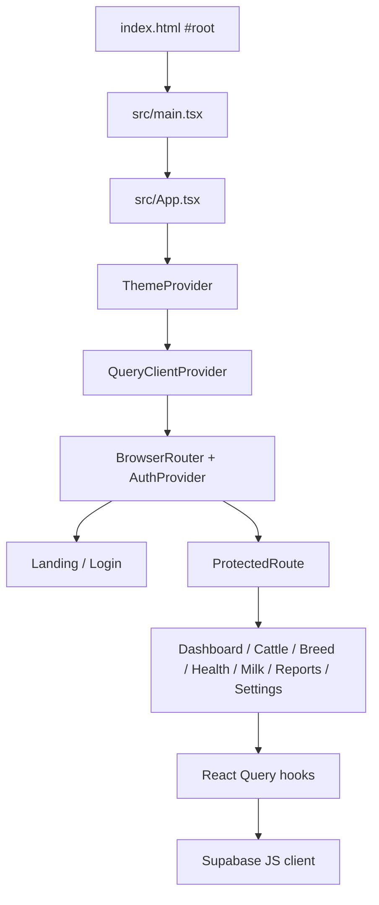
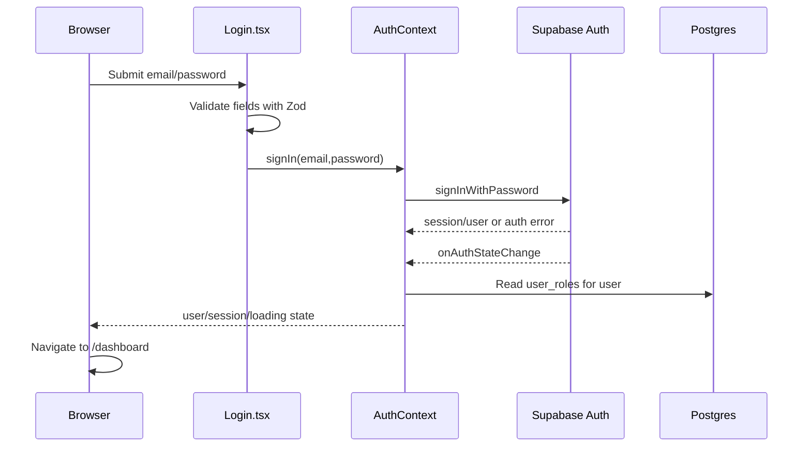
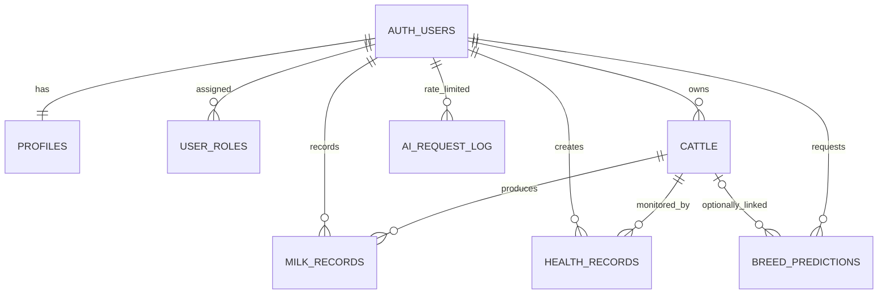
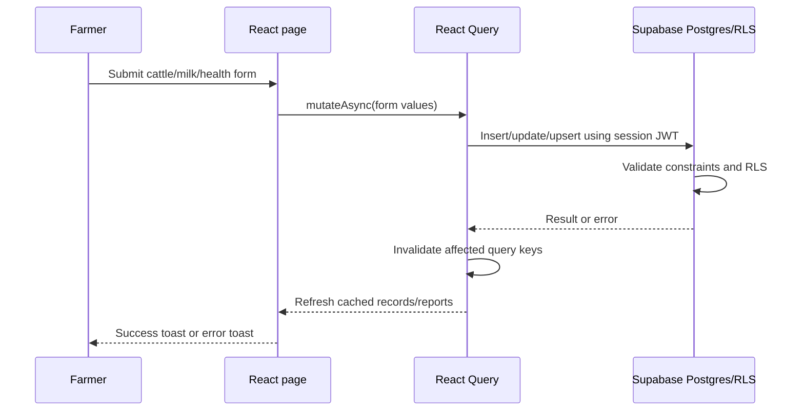
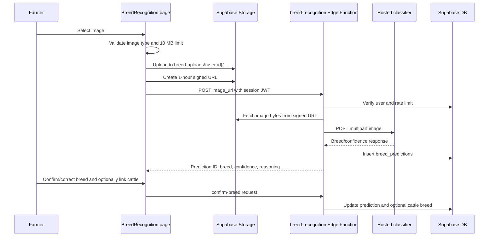
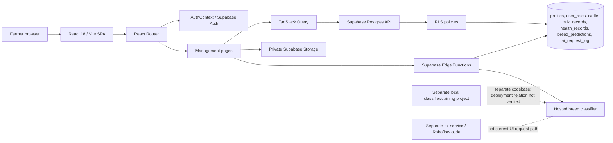

# SmartDairy AI — Complete Technical Knowledge Base

> **Purpose:** A source-grounded technical reference for future engineering reports, presentations, research, deployment, and maintenance. This is not a submission-ready academic report.
>
> **Evidence date:** 2026-10-25. Repository files are the primary evidence. “Implemented” means present in the checked-out source; cloud behavior is not assumed to match local source unless explicitly verified. Environment variable values, API keys, and credentials are intentionally omitted.

## How to read status labels

| Label | Meaning |
|---|---|
| **Implemented and verified** | Source supports the feature and a stated local check or evidence confirms the specified behavior. |
| **Implemented; not fully tested** | Relevant source exists, but the user workflow or live backend was not fully exercised. |
| **Partially implemented** | Some of the intended flow exists but source evidence shows gaps or inconsistencies. |
| **Planned** | A future proposal, not an existing product capability. |
| **Not verified** | Available local evidence is insufficient; further checks are specified. |

## A. Project overview

**Project name:** SmartDairy AI — AI-Based Smart Dairy Management System.

The current frontend is a React single-page application for dairy-farm records and management. It provides cattle records, daily milk entries, health/vaccination records, summary reports, user profile/preferences, and an image-based breed-recognition workflow. Supabase provides authentication, Postgres, Storage, and Edge Functions. Breed recognition is connected in source through a Supabase Edge Function to a hosted image classifier.

### Problem and goals

The intended problem is keeping farm, cattle, milk, and health information in one system and making breed identification easier. Implemented management features are conventional forms, database records, filters, charts, and summaries. Breed inference is the AI-specific workflow; charts and yield arithmetic are not trained machine-learning predictions.

### Users and scope

- **Primary users:** farmers and dairy-farm operators.
- **Additional role in schema:** administrators, represented by `user_roles`.
- **Current local scope:** browser frontend under `src/`, Supabase schema and functions under `supabase/`, plus separate breed-classifier and legacy ML-service code.
- **Not established:** production user base, production data volumes, uptime, or deployed Supabase state.

### Current completion snapshot

| Area | Status | Evidence / qualification |
|---|---|---|
| SPA shell, landing page, navigation, themes | Implemented and locally verified | `src/main.tsx`, `src/App.tsx`, `src/pages/Landing.tsx`, `src/contexts/ThemeContext.tsx`; local browser rendered landing page. |
| Email/password and Google auth UI | Implemented; cloud auth not verified | `src/pages/Login.tsx`, `src/contexts/AuthContext.tsx`; Supabase host failed DNS resolution during the 2026-10-25 connectivity check. |
| Farm records and reports | Implemented; live data access not fully verified | Pages, hooks, migrations, and Edge Functions exist. |
| Breed recognition | Implemented as an integration path; hosted model availability not currently verified | Upload → signed URL → Edge Function → hosted classifier → prediction record path exists in source. |
| Dataset and offline experiments | Artifacts and code present; reproducibility incomplete | Classifier audit and `cattle-breed-classifier-webapp-master/ml/`; no local model checkpoint was found. |
| Automatic reminders/notifications | Partially implemented | Notification preference fields and UI exist; no verified outbound email, SMS, or push delivery implementation was found. |
| Production deployment | Not verified | Local Vite configuration and deployment artifacts exist in separate classifier project; no current production deployment was established. |

## B. Technology stack and repository structure

### Frontend stack

Versions below are declared in the root `package.json` (caret ranges), not claims about an exact lock-resolved runtime version.

| Technology | Declared version / role |
|---|---|
| React / React DOM | `^18.3.1`; component UI |
| TypeScript | `^5.8.3`; application and configuration source |
| Vite | `^5.4.19`; development server and production bundler |
| React Router | `^6.30.1`; browser routes |
| TanStack React Query | `^5.83.0`; remote query cache and mutations |
| Supabase JS | `^2.105.1`; Auth, database, Storage, Edge Function calls |
| Tailwind CSS | `^3.4.17`; utility styling |
| Radix UI / shadcn-style local components | Radix primitives plus `src/components/ui/` |
| Recharts | `^3.8.1`; charts |
| Zod | `^3.25.76`; login/signup input validation |
| Vitest / Testing Library / jsdom | `^3.2.4`, `^16.0.0`, `^20.0.3`; unit test setup |
| ESLint | `^9.32.0`; lint script |

### Important paths

| Path | Responsibility |
|---|---|
| `src/main.tsx` | React root mount and global stylesheet import. |
| `src/App.tsx` | Theme, query, tooltip, toast, router, auth providers and route table. |
| `src/pages/` | Landing, login, dashboard, cattle, breed, health, milk, reports, settings, and not-found screens. |
| `src/components/layout/` | Sidebar, top bar, floating actions, help widget, and shared dashboard shell. |
| `src/components/ui/` | Reusable accessible UI primitives. |
| `src/contexts/AuthContext.tsx` | Supabase session, user, role, auth actions. |
| `src/contexts/ThemeContext.tsx` | Light/dark theme preference and local persistence. |
| `src/hooks/useDairy.ts` | React Query access to Supabase tables and reports function. |
| `src/integrations/supabase/client.ts` | Browser Supabase client, configured from Vite variables. |
| `src/integrations/supabase/types.ts` | Generated-style database typing. |
| `src/data/breed-catalog.ts` | Static breed labels and metadata used by the UI. |
| `src/test/` | Vitest setup and currently minimal test coverage. |
| `supabase/migrations/` | SQL schema, policies, triggers, storage buckets/policies, and later changes. |
| `supabase/functions/` | Reports, demo-data, breed inference, confirmation, and shared CORS helper. |
| `cattle-breed-classifier-webapp-master/` | Separate dataset/training/classifier project, manifests, experiment artifacts, and independent web/API/deployment code. |
| `ml-service/` | Separate/legacy FastAPI and Roboflow/PyTorch integration; not the current UI request path. |
| `docs/API.md` | Older API documentation; several statements conflict with current source (see §Q). |
| `SMARTDAIRY_MAIN_BACKEND_CODE.md` | Backend source excerpts; its breed section reflects a hosted classifier, unlike older API documentation. |

### Local commands and configuration

```powershell
npm install
npm run dev
npm run build
npm test
npm run lint
```

- `npm run dev` starts Vite on port `8080` per `vite.config.ts`.
- `npm run build` outputs to `dist/`.
- `npm test` runs `vitest run`; `npm run lint` runs ESLint.
- Root Vite has an `/api` proxy to `http://localhost:8000`, but the current SmartDairy frontend data calls use Supabase JS rather than this proxy.
- Package manager evidence is mixed: root has `package-lock.json` and Bun lock files; npm scripts were used in local checks.

## C. Frontend architecture and routes

### Startup and provider tree

`index.html` contains `#root` and loads `/src/main.tsx`. `main.tsx` mounts `<App />`; `App.tsx` composes `ThemeProvider`, `QueryClientProvider`, tooltip/toast UI, `BrowserRouter`, and `AuthProvider`. Route elements render inside the auth provider. The application uses eager imports for pages; a module import/runtime error in a page can therefore prevent the entire app bundle from mounting.



### Route inventory

| Route | Page | Auth requirement | Main behavior | Verification status |
|---|---|---|---|---|
| `/` | `Landing.tsx` | Public | Product landing, feature sections, estimate calculator, theme toggle, navigation. | Rendered locally without browser runtime errors on 2026-10-25. |
| `/login` | `Login.tsx` | Public | Password sign-in, sign-up, Google OAuth; Zod validation. | Login screen locally rendered; Supabase connectivity/auth unavailable in the last check. |
| `/dashboard` | `Dashboard.tsx` | Protected | Summary cards, milk/health charts, alerts, demo-data action, quick navigation. | Prior local route check showed redirect to login without a session. The `useState` import and `profile`/`user` bindings were corrected; authenticated dashboard data view remains unverified. |
| `/cattle` | `CattleManagement.tsx` | Protected | Search/filter, add/edit/delete/detail interactions. | Source-confirmed; not fully exercised against live data. |
| `/breed-recognition` | `BreedRecognition.tsx` | Protected | Upload image, infer breed, view predictions, confirm result. | Source-confirmed; external classifier path not currently verified. |
| `/health` | `HealthMonitoring.tsx` | Protected | Health/vaccination records, statuses, alerts, paged listing. | Source-confirmed; not fully exercised against live data. |
| `/milk-production` | `MilkProduction.tsx` | Protected | Add daily morning/evening milk, paged records and charts. | Source-confirmed; not fully exercised against live data. |
| `/reports` | `Reports.tsx` | Protected | Summary charts and daily CSV download. | Source-confirmed; not fully exercised against live data. |
| `/settings` | `Settings.tsx` | Protected | Profile fields, notification preferences, theme. | Source-confirmed; not fully exercised against live data. |
| `*` | `NotFound.tsx` | Public | Unknown-route message and return link. | Source-confirmed. |

`src/pages/Index.tsx` exists as a placeholder but is not used by the route table.

### Feature notes

- **Landing:** static product descriptions include a yield estimate using `herdSize * 14.5 * 30`; this is a user-facing calculation, not a model output. Its copy claims Gemini for breed recognition, which conflicts with current function source.
- **Dashboard:** calls reports and profile hooks, reads authenticated user context, and can invoke `seed-demo-data`. Charts render from reports response. It has a corrected React `useState` import in current local source.
- **Cattle:** form fields include tag, name, breed, age, gender, color, health status, milk yield, notes. Search matches name/tag/breed; filters include breed, gender, health status. Database uniqueness is `(owner_id, tag)`. Image storage is provisioned in SQL but no cattle-image upload flow was confirmed in the inspected page.
- **Milk:** filters the cattle selector to female cattle. Form accepts date, morning/evening amounts, notes; data upserts on `(cattle_id, date)`. Current page aggregates the monthly chart using only the current records page (up to 50 rows).
- **Health:** records condition, treatment, veterinarian, date, next checkup, and status. UI alert computation uses the currently paged health rows. This is not a notification delivery system.
- **Reports:** uses the reports Edge Function and offers CSV export of daily date/total rows; it does not export all tables.
- **Settings:** profile updates and notification preferences are persisted through profile mutations; theme is stored in browser local storage.

## D. Authentication and authorization

### Frontend auth sequence

`AuthProvider` registers `onAuthStateChange`, restores state using `supabase.auth.getSession()`, then exposes `user`, `session`, `role`, `loading`, and sign-in/up/out functions. Role lookup queries `user_roles` and uses `"farmer"` if no role row is returned. `ProtectedRoute` displays a spinner while auth is loading and navigates unauthenticated users to `/login`; it does not preserve the original destination.



- Sign-up sends `full_name` and `farm_name` as auth metadata and sets email redirect to `/dashboard`.
- SQL `handle_new_user` trigger creates a profile and default farmer role on `auth.users` insertion.
- Google OAuth is initiated by `signInWithOAuth({ provider: "google", redirectTo: .../dashboard })`. Provider enablement and redirect allow-list depend on cloud project settings and are **not verified**.
- Supabase client reads `VITE_SUPABASE_URL` and `VITE_SUPABASE_PUBLISHABLE_KEY`, persists auth to `localStorage`, and enables auto-refresh.
- Last connectivity investigation found the configured host `lfnirxpxeyopzazvjtpa.supabase.co` did not resolve (browser `ERR_NAME_NOT_RESOLVED`, DNS-over-HTTPS NXDOMAIN). The required variables were present/nonempty and URL format matched a Supabase project hostname. This proves the configured endpoint was unreachable at that time, not whether the project was paused, deleted, or mistyped. Re-check before relying on this finding.

### Authorization and RLS

The frontend does not append owner filters to every query. Security depends on the database policies. Migration source enables RLS on application tables and restricts records by `auth.uid()` and cattle ownership, with admin exceptions according to table/policy. RLS presence is evidence of a control, not a blanket security guarantee; live policies and authenticated behavior require review against the deployed project.

## E. Database schema and relationships

The following is derived from four checked-in migrations. It documents intended schema from source, not a live cloud schema introspection. Types are PostgreSQL types; nullable unless marked `NOT NULL`.

### Enumerations

| Enum | Values |
|---|---|
| `app_role` | `admin`, `farmer` |
| `gender_t` | `Male`, `Female` |
| `health_t` | `Healthy`, `At Risk`, `Critical` |
| `vacc_status_t` | `Scheduled`, `Upcoming`, `Overdue`, `Completed` |

### Tables

| Table | Columns and constraints |
|---|---|
| `profiles` | `id UUID NOT NULL` PK/FK to `auth.users(id) ON DELETE CASCADE`; `full_name TEXT`; `farm_name TEXT`; `phone TEXT`; `avatar_url TEXT`; `created_at TIMESTAMPTZ NOT NULL DEFAULT now()`; `updated_at TIMESTAMPTZ NOT NULL DEFAULT now()`; later `notification_preferences JSONB NOT NULL DEFAULT {"health_alerts":true,"vaccination_reminders":true,"milk_reports":false}`. |
| `user_roles` | `id UUID NOT NULL DEFAULT gen_random_uuid()` PK; `user_id UUID NOT NULL` FK to auth user cascade; `role app_role NOT NULL`; `created_at TIMESTAMPTZ NOT NULL DEFAULT now()`; unique `(user_id, role)`. |
| `cattle` | `id UUID NOT NULL DEFAULT gen_random_uuid()` PK; `owner_id UUID NOT NULL` FK to auth user cascade; `tag TEXT NOT NULL`; `name TEXT NOT NULL`; `breed TEXT NOT NULL`; `age INTEGER NOT NULL DEFAULT 0`; `gender gender_t NOT NULL DEFAULT 'Female'`; `color TEXT`; `health_status health_t NOT NULL DEFAULT 'Healthy'`; `milk_yield NUMERIC(6,2) NOT NULL DEFAULT 0`; `purchase_date DATE`; `notes TEXT`; `image_url TEXT`; `created_at`, `updated_at TIMESTAMPTZ NOT NULL DEFAULT now()`; unique `(owner_id, tag)`. |
| `milk_records` | `id UUID NOT NULL DEFAULT gen_random_uuid()` PK; `cattle_id UUID NOT NULL` FK to cattle cascade; `date DATE NOT NULL DEFAULT CURRENT_DATE`; `morning`, `evening NUMERIC(6,2) NOT NULL DEFAULT 0`; `total NUMERIC(6,2)` generated stored as `morning + evening`; `notes TEXT`; `recorded_by UUID NOT NULL` FK to auth user cascade; `created_at TIMESTAMPTZ NOT NULL DEFAULT now()`; unique `(cattle_id, date)`. |
| `health_records` | `id UUID NOT NULL DEFAULT gen_random_uuid()` PK; `cattle_id UUID NOT NULL` FK to cattle cascade; `condition TEXT NOT NULL`; `treatment TEXT`; `vet_name TEXT`; `date DATE NOT NULL DEFAULT CURRENT_DATE`; `next_checkup DATE`; `status vacc_status_t NOT NULL DEFAULT 'Scheduled'`; `created_by UUID NOT NULL` FK to auth user cascade; `created_at TIMESTAMPTZ NOT NULL DEFAULT now()`. |
| `breed_predictions` | `id UUID NOT NULL DEFAULT gen_random_uuid()` PK; `user_id UUID NOT NULL` FK to auth user cascade; `image_url TEXT NOT NULL`; `predicted_breed TEXT NOT NULL`; `confidence NUMERIC(5,2) NOT NULL`; `reasoning TEXT`; `confirmed_breed TEXT`; `cattle_id UUID` FK to cattle `ON DELETE SET NULL`; `created_at TIMESTAMPTZ NOT NULL DEFAULT now()`. |
| `ai_request_log` | `id UUID NOT NULL DEFAULT gen_random_uuid()` PK; `user_id UUID NOT NULL` (no FK declared); `endpoint TEXT NOT NULL`; `created_at TIMESTAMPTZ NOT NULL DEFAULT now()`. |

No SQL `CHECK` constraints were declared in the migrations reviewed. Unique constraints enforce the user/tag, user/role, and cattle/date invariants. Named indexes include cattle owner; milk and health cattle/date descending; prediction user/created-at descending; and AI request user/endpoint/time. Constraint backing indexes also exist.

### Functions, triggers, delete behavior

- `has_role(_user_id, _role)` is stable SQL, `SECURITY DEFINER`, fixed `search_path = public`, and checks `user_roles`. Migration sequence revokes then grants execute to `authenticated, anon`.
- `set_updated_at()` assigns `NEW.updated_at = now()`; update triggers attach it to `cattle` and `profiles`.
- `handle_new_user()` is a `SECURITY DEFINER` trigger function with fixed search path; it creates a profile from auth metadata/email and inserts farmer role. Trigger runs after auth-user insertion. Execute privileges are revoked from public/anon/authenticated.
- Deleting auth users cascades profile, role, cattle owner, milk/health creator, and prediction rows as specified by FKs. Deleting cattle cascades milk/health rows; prediction cattle association becomes null.

### RLS policy summary from migrations

| Table | Policy intent |
|---|---|
| `profiles` | Owner can read/insert/update own row; admin read policy. |
| `user_roles` | Owner can read own roles; admins manage roles. |
| `cattle` | Owner-scoped CRUD; admins have read/update/delete exceptions as declared. |
| `milk_records` | Reads and writes checked through related cattle ownership; inserts also require `recorded_by = auth.uid()`. Admin read policy exists; update/delete remain owner-scoped according to migration. |
| `health_records` | Reads and writes checked through related cattle ownership; inserts also require `created_by = auth.uid()`. Admin read policy exists; update/delete remain owner-scoped according to migration. |
| `breed_predictions` | Owner-scoped CRUD; admin read exception. |
| `ai_request_log` | Owner-only select and insert. |
| Storage objects | Private `cattle-images` and `breed-uploads`; policies scope object paths to the caller’s user-id folder; admins can read under policy. Cattle image supports upload/read/update/delete. Breed uploads support read/upload/delete; no update policy was identified. |

### ER diagram



## F. Backend APIs and workflows

### Current backend architecture

SmartDairy’s browser code uses Supabase JS directly for Auth, Postgres, Storage, and function invocation. Four Deno Edge Functions are checked in. Each uses `SUPABASE_URL` and `SUPABASE_ANON_KEY`, validates the bearer token through `auth.getUser()`, and applies shared CORS headers. `supabase/config.toml` sets `verify_jwt = false` on the four functions; therefore the source’s explicit user validation is important. Whether the deployed code/config matches local source is not verified.

### Edge Function inventory

| Function | Request and behavior | Response/errors | Verification |
|---|---|---|---|
| `breed-recognition` | `POST { image_url }`; validates auth, URL syntax/protocol and length; checks per-user max five requests per minute using `ai_request_log`; downloads image; sends multipart `file` to hosted Hugging Face Spaces classifier; stores `breed_predictions`. | Success `{ prediction_id, breed, confidence, reasoning }`; source handles 400 invalid input/download, 401 auth, 429 throttling, 502/503 classifier issues, 500 unexpected/database failures. | Local code verified; remote service and cloud deployment not verified. |
| `confirm-breed` | `POST { prediction_id, confirmed_breed, cattle_id? }`; validates auth/input, updates prediction and optionally the linked cattle breed. | Success `{ success: true, prediction }`; 400/401/500 classes. Source logs cattle update failures but still may return overall success. | Local code only. |
| `reports` | `GET`; reads cattle, last-30-day milk, and up to 20 upcoming/overdue health rows using caller JWT and RLS; computes summaries/distributions. | Summary fields, health/breed distributions, daily milk, alerts; 401 or 500 on errors. | Local code only; cloud connectivity previously failed DNS. |
| `seed-demo-data` | `POST`; if the caller has no cattle, inserts six cattle, seven days of milk records, and three health records. | `{ success, cattle }` or `{ skipped: true, message }`; auth and server errors. | Local code only. |

Source paths: `supabase/functions/{breed-recognition,confirm-breed,reports,seed-demo-data}/index.ts` and `supabase/functions/_shared/cors.ts`.

### Dashboard/report calculation behavior

- Cattle totals, health counts, and breed counts are grouped in `reports`.
- Milk query covers the rolling previous 30 days and groups by date. `month_milk` is therefore a rolling 30-day sum, not a calendar-month sum.
- `week_milk` includes dates greater than or equal to the date seven days before “today”; `today_milk` matches current UTC date string.
- `avg_per_cattle` is `weekTotal / 7 / totalCattle`, rounded to one decimal place.
- Alerts exclude `Completed`, include `Overdue` or a `next_checkup` no later than seven days ahead, order by next checkup, and are limited to 20.

### Main data workflows



Breed workflow:



## G. Cattle management

The cattle page reads records ordered newest-first, filters client-side by search text (name, tag, breed), breed, gender, and health status. Add and edit share a form covering tag/name/breed/age/gender/color/health status/milk yield/notes. If add-form values are empty, code supplies default-like values (generated `C###` tag based on current list size, `"New Cattle"`, `"Indigenous"`, age 1, female, healthy, zero yield). This client-generated tag can collide if records are deleted or concurrent creates occur; database uniqueness remains the final safeguard.

Delete is available in UI. Due FK cascade, deleting a cattle row also deletes associated milk and health records; linked predictions remain but their cattle reference becomes null. The page exposes image URL fields in the type/schema, but a complete cattle-photo upload lifecycle was not confirmed in the inspected UI.

## H. Milk production

- The daily form chooses a cattle, date, morning/evening liters, and optional notes.
- `useAddMilk` sets `recorded_by` from the current user and upserts on `cattle_id,date`; a second daily entry updates that cattle/date row instead of creating a duplicate.
- Database `total` is generated as morning plus evening. The UI uses that value in records/charts.
- List query requests 50 rows per page with exact count, newest date first. Previous/next controls are present.
- Dashboard/report aggregates are from the Edge Function’s rolling date window; the local “Monthly Overview” chart groups only the current page’s 50 or fewer fetched rows by `YYYY-MM`.
- There are no migration check constraints ensuring nonnegative or realistic milk values. The form converts nonnumeric/empty quantities to zero; no maximum is evident in the inspected form.

## I. Health monitoring and alerts

Health records store condition, treatment, veterinarian, record date, optional next checkup, status, and creator. Add form requires cattle and condition; records are paged newest-first in groups of 50. Status values are `Scheduled`, `Upcoming`, `Overdue`, `Completed`.

- Page-level alerts use only current page rows and show records with status `Overdue` or due date on/before current UTC date, excluding completed.
- Reports function independently selects up to 20 overdue or next-checkup-within-seven-days records. The different time windows and page limitation mean dashboard and health-page alert counts may not match.
- No email, SMS, push, or background reminder delivery was identified. Settings switches persist preferences but do not establish delivery behavior.

## J. AI cattle-breed recognition

### Active SmartDairy source integration

The recognized current UI path is a private Storage upload followed by an authenticated Edge Function call. The function sends the downloaded image to the configured hosted classifier, persists a prediction, and returns the prediction fields. It is not a direct browser-to-Gemini call and does not currently use the local `ml-service` path.

### Model and vocabulary

- The main UI includes a static breed catalog in `src/data/breed-catalog.ts`; catalog entries and metadata are not evidence of model training.
- The separate `cattle-breed-classifier-webapp-master/` contains data preparation, training and evaluation code for MLP, CNN, ResNet-50, and ViT-B/16, manifests and experiment artifacts.
- A checked-in classifier audit dated 2026-10-08 reports 3,056 decodable 256×256 RGB JPEGs across 26 classes, with 36–250 images per class and 2,139/458/459 train/validation/test records. Treat those as audit observations; re-count if required for publication.
- Stored ResNet test report records accuracy 0.6318 and macro-F1 0.5606 on 459 test images. Stored ViT report records accuracy 0.6318 and macro-F1 0.5465. These are existing artifact metrics, not newly reproduced results.
- Existing classifier audit ranks ResNet first in a composite comparison, while the deployment config/audit describes ViT v2.0 as the hosted model. The currently active deployed checkpoint and current remote availability are **not verified** in this knowledge base.
- No `.pth`, `.pt`, `.ckpt`, `.onnx`, or `.safetensors` local checkpoint was found in the checked-out tree. Classifier deployment expects a ViT checkpoint. Thus local model execution and reported experiment reproduction are incomplete.
- Catalog label discrepancy: audit says the local dataset includes Umblachery but not Vechur; SmartDairy catalog includes Vechur and omits Umblachery.
- Dataset provenance and reuse license are not verified. The classifier project has an MIT software license; that license does not establish image-data licensing.

### Current versus proposed AI

**Current source:** externally hosted classifier behind `breed-recognition` Edge Function. Its classifier identity is a hard-coded hosted endpoint in function source. Model service and Supabase function deployment availability are external dependencies.

**Planned only (not represented as completed):** versioned reproducible weights; documented source/licensing for each image; repeatable training and validation; independent held-out evaluation; calibrated confidence; serving API with stable version/class map; monitoring and model rollback; improved UX for uncertainty.

Potential research pipeline (proposal, not implementation evidence): prepare licensed labeled dataset; split by animal/source to avoid image leakage; compare transfer-learned EfficientNet/ResNet/ViT; document preprocessing/augmentation; select optimizer, loss, and learning rate on validation only; freeze test set; report accuracy, macro precision/recall/F1, per-class support, confusion matrix, calibration, and inference latency; export a versioned checkpoint and class map; deploy behind authenticated service.

## K. Dataset and experiment evidence

The dedicated classifier audit (`cattle-breed-classifier-webapp-master/CATTLE_BREED_CLASSIFIER_MASTER.md`) inventories the local images, manifests, and reports. It records that training and evaluation source/artifacts exist but weights are absent from this checkout. Do not imply current SmartDairy requests run those local weights.

| Experiment field | Evidence currently available |
|---|---|
| Dataset | 3,056 images / 26 classes per audit; source and redistribution rights not verified. |
| Class distribution | Audit gives 36–250 examples per class; imbalanced. |
| Split | 2,139 train / 458 validation / 459 test in manifests. |
| Model families | MLP, CNN, ResNet-50, ViT-B/16 source and reports. |
| Stored best comparison | ResNet-50 ranked first by stored composite score; deployment selection differs. |
| Stored ResNet results | Accuracy 63.18%, macro precision 58.41%, macro recall 56.32%, macro F1 56.06% on 459 examples. |
| Stored ViT results | Accuracy 63.18%, macro precision 56.48%, macro recall 55.11%, macro F1 54.65% on 459 examples. |
| Epochs, batch size, optimizer, learning rate | Configuration/history evidence exists in classifier project; values should be copied from the exact run/config paired with the report before publication. Not independently re-executed here. |
| Hardware, evaluation date, independent reproduction | Not verified for the stored metrics. |
| Checkpoint | No local checkpoint found. |
| License/provenance | Not verified for dataset images. |

Before writing a research conclusion, capture the exact code revision/config, dataset provenance and license, split-generation method, class mapping, model checkpoint hash, hardware/software versions, run logs, raw predictions, metrics calculation, and reproducible evaluation command.

## L. Analytics and future machine learning

Implemented analytics are aggregations and visualizations: cattle counts by health and breed; milk totals by day/week/rolling 30 days; average weekly milk per cattle; alert counts; chart rendering. No deployed milk-yield forecasting model was found. Any yield-prediction work should be separately marked planned and should collect longitudinal cattle-level milk, feed, lactation stage, health, environment, and farm context while avoiding leakage between train/test periods or animals.

## M. Storage, security, and privacy

### Implemented controls in migrations/source

- Supabase Auth sessions persist in browser local storage; frontend uses the publishable client key, not a service-role key.
- Application tables have RLS policies; owner identity/related cattle ownership controls access. Validate deployed policy definitions against migrations before making a security claim.
- `cattle-images` and `breed-uploads` are private buckets with user-folder path policies. Breed flow uses a one-hour signed URL.
- Edge Functions check the caller JWT with `auth.getUser()`. Breed inference applies five-request-per-minute per-user throttling via `ai_request_log`.
- Shared CORS source allows all origins; this is permissive and should be assessed against actual threat model/deployment requirements.

### Risks and gaps requiring attention

1. **Legacy hard-coded Roboflow API-key fallback:** source review found a credential fallback in `ml-service/roboflow_service.py`. Do not reproduce the value in documentation. Treat it as potentially exposed; remove the fallback, rotate the credential with the provider, and inspect history if this path is ever activated. This legacy service is not the active SmartDairy UI inference path.
2. `breed-recognition` accepts any HTTP(S) image URL and fetches it server-side. The UI normally supplies a signed Storage URL, but server-side URL validation should restrict destinations to reduce SSRF risk.
3. Rate-limit query/insert errors are logged but do not stop inference; throttling may fail open when the log cannot be written.
4. `confirm-breed` can log a cattle update failure yet return success for the overall operation.
5. Demo seeder does not check milk/health insert errors after cattle insert and can report success with partial sample data.
6. Preferences currently persist values only; delivery mechanisms were not found.
7. Dataset licensing, retention/deletion of uploaded images, hosted classifier terms, and production privacy posture are not verified.

## N. Error handling, performance, and tests

- Mutations commonly throw Supabase errors; page components show toast success/error. Query pages often render from empty fallback arrays, so a query error may look like an empty dataset unless a separate error state is added.
- React Query caches records and mutations invalidate related keys. `PAGE_SIZE = 50`; breed prediction history limits to 20.
- The public test suite contains `src/test/example.test.ts`, a trivial assertion; it is not meaningful feature regression coverage.
- `npm run build` passed in this documentation task (2026-10-25); Vite reported stale Browserslist metadata and a minified chunk larger than 500 kB.
- `npm test` passed with one test in this documentation task (2026-10-25). This establishes only the test runner/basic placeholder assertion.
- A current direct `npx tsc --noEmit -p tsconfig.app.json` check (2026-10-25) exited 2 with three outstanding diagnostics: unresolved `AlertRow` in `src/hooks/useDairy.ts`, unresolved `PredictionRow` in `src/pages/BreedRecognition.tsx`, and a Recharts `PieLabel` callback typing mismatch in `src/pages/Reports.tsx`. The earlier missing `profile`/`user` Dashboard bindings have since been added; no Dashboard diagnostic remains.
- `npm run lint` completed with 0 errors and 9 `react-refresh/only-export-components` warnings in shared UI/context files.

| Test area | Expected result | Actual evidence | Status |
|---|---|---|---|
| Production build | Vite exits successfully | `npm run build` exited 0 (2026-10-25) | Verified locally; warnings remain |
| Unit test | Feature behavior checks pass | `npm test`: one placeholder test passed (2026-10-25) | Test command verified; behavior coverage inadequate |
| ESLint | No lint errors | `npm run lint`: 0 errors, 9 Fast Refresh export warnings (2026-10-25) | Verified with warnings |
| TypeScript no-emit | Application type-check exits 0 | `npx tsc --noEmit -p tsconfig.app.json`: 3 errors listed above | Fails; pre-existing unresolved types/callback typing |
| Landing runtime | Root renders meaningful content without page error | Browser showed landing page, no JS errors | Verified at local check |
| Protected routing | Unauthenticated protected URL redirects to login | Browser redirected `/dashboard` to `/login` | Verified without session |
| Authenticated Dashboard | Dashboard renders with session and Supabase data | No test account/session; prior Supabase DNS failure | Not verified |
| CRUD/RLS | Owner can operate own records; other users cannot | Policies in migrations only | Not verified against live cloud |
| Breed inference/confirmation | Successful prediction is saved and confirmed | Local source implements flow; hosted services unavailable/unverified | Not verified end-to-end |

## O. Deployment and environment configuration

### Current local setup

- Vite development server configured for `localhost:8080`; `npm run build` creates `dist/`.
- Supabase project configured through `.env`; values are intentionally omitted. No `.env.local` was present during the 2026-10-25 check.
- `supabase/config.toml` sets project reference and function JWT gateway setting. It does not prove a successful deployment.
- The classifier subproject has Docker/FastAPI deployment artifacts and reports a hosted Hugging Face Spaces API; live state is not independently verified here.
- A separate root `ml-service/` includes FastAPI-related code and Roboflow/PyTorch paths; no active frontend route to it was identified.
- SPA hosting must provide an index.html fallback for direct routes. OAuth redirect allow-list must include deployed origin and `/dashboard`.

### Sanitized environment variable inventory

| Variable name | Purpose / consumer | Required? | Secret? | Source/config location |
|---|---|---:|---:|---|
| `VITE_SUPABASE_URL` | Browser Supabase project URL | Yes | No | Root `.env`; `src/integrations/supabase/client.ts` |
| `VITE_SUPABASE_PUBLISHABLE_KEY` | Supabase browser publishable/anon key | Yes | Public client credential (not service-role) | Root `.env`; Supabase client |
| `VITE_SUPABASE_PROJECT_ID` | Project identifier | Present in root config, not referenced in `src/` | No | Root `.env` |
| `SUPABASE_URL` | Server-side Supabase endpoint | Yes for Edge Functions | No | Supabase Function runtime |
| `SUPABASE_ANON_KEY` | Edge Function Supabase client key, with caller JWT forwarded | Yes for Edge Functions | Public/anon role key; do not confuse with service-role | Supabase Function runtime |
| Roboflow-related variables | Legacy `ml-service` provider/model config | Required only if that service is used | Provider token is secret | `ml-service` source/config; exact names are source-dependent |
| `MODEL_PATH`, `METADATA_PATH`, `CLASSES_PATH`, `MODEL_NAME`, `MODEL_VERSION` | Standalone classifier model and metadata configuration | Required by configured classifier deployment | Paths/version not secret | Classifier backend config and Docker deployment |

Never place service-role credentials in browser variables or frontend bundles. Do not commit `.env` values.

## P. Architecture and example workflows

### Verified current source architecture



### Workflow summary

1. **Register:** login form validates email/password/name/farm; Supabase Auth inserts account; database trigger creates profile and farmer role. Email confirmation behavior depends on cloud settings and is not verified.
2. **Add cattle:** authenticated page submits fields through `useUpsertCattle`; owner ID is attached from current user; uniqueness and RLS apply.
3. **Record milk:** page submits date and morning/evening amounts; hook sets `recorded_by`, upserts on cattle/date, invalidates milk/report queries; database computes total.
4. **Add health record:** page submits cattle and condition with optional treatment/vet/dates/status; hook attaches current user as creator and invalidates health/report data.
5. **Dashboard:** reports Edge Function queries caller-visible rows and aggregates counts, distributions, production and alerts; profile hook loads current profile.
6. **Predict breed:** upload image to private bucket, create signed link, call authenticated Edge Function, fetch hosted inference, persist prediction, optionally confirm it and update cattle. Successful live execution is not currently verified.
7. **View reports:** report function returns aggregates; UI displays charts and exports daily totals as CSV.

Illustrative names and values in screens or seeded demo rows are synthetic examples, not production observations.

## Q. Discrepancies, limitations, and roadmap

### Documentation/source discrepancies

| Existing statement or mismatch | Current source evidence | Resolution in this reference |
|---|---|---|
| `docs/API.md` says breed recognition uses Lovable AI/Gemini and mentions AI credits. | Current `supabase/functions/breed-recognition/index.ts` posts image to a hosted classifier endpoint. | Treat current function source as implementation evidence; older API text is stale. |
| API doc says `seed-demo-data` is idempotent and describes exact behavior. | Function skips if any cattle exist; milk/health insert errors are not checked. | “Skip if any cattle” is documented; partial inserts are called out. |
| `month_milk` sounds calendar-month based. | Reports function sums last 30 days. | Identified as rolling 30-day total. |
| Landing page describes Gemini; breed page wording mentions Roboflow. | Active function source invokes hosted Hugging Face classifier. | Marketing/UI copy does not establish active provider. |
| Dataset catalog differs from classifier labels. | Local dataset includes Umblachery and not Vechur; frontend catalog includes Vechur and omits Umblachery. | Marked as class/catalog mismatch. |
| ResNet is stored evaluation winner but ViT is deployment choice in classifier audit/config. | Stored comparison and deployment config differ; no local checkpoint. | No claim that the locally stored winner powers live inference. |
| Settings has notification toggles. | No outgoing notification delivery path found. | Preferences are documented, actual delivery is not. |
| Previous API doc says all Edge calls use JWT and some behavior details not matching source. | Config sets `verify_jwt=false`; functions perform explicit `getUser()` validation. | This implementation detail is highlighted. |

### Evidence-backed gaps and priorities

| Priority | Gap | User/research impact | Suggested next action |
|---|---|---|---|
| High | Supabase endpoint DNS failure observed on 2026-10-25 | Login/database calls cannot reach project when unresolved | Confirm project reference and status in Supabase dashboard, correct URL/key if stale, then restart Vite and re-test. |
| High | Legacy hard-coded Roboflow credential fallback | Credential exposure risk if source is distributed or legacy service is run | Remove fallback, rotate provider credential, review source history and access logs. |
| High | Server-side arbitrary HTTP(S) image fetch in breed function | SSRF exposure if function endpoint is abused | Restrict allowed host/bucket paths and validate signed URL origin; consider safer object retrieval. |
| High | No local classifier checkpoint | Experiments and deployment cannot be reproduced from this checkout | Securely version/host weights with hashes and documented class mapping. |
| Medium | TypeScript check has reported existing type issues | Type safety problems can escape Vite transpile-only builds | Fix unresolved `AlertRow`/`PredictionRow` types and Recharts callback types; rerun typecheck. |
| Medium | Prediction confirmation UI may be unreachable from initial state | User may not be able to confirm/link a result | Review the actual state setter and conditional rendering in `BreedRecognition.tsx`; verify through browser. |
| Medium | Page-level health/milk aggregates use paginated data | Charts/alerts may undercount historical records | Compute totals server-side or fetch all relevant records for the chart. |
| Medium | Reports function alert criteria differ from health page | Different alert counts/urgency across screens | Share a single documented alert rule and test boundaries. |
| Medium | Demo seeder can partially succeed | UI may claim loaded while milk/health inserts failed | Check and report every insert error; use transaction/compensating behavior. |
| Low | Test suite has only a placeholder test | Regressions in auth, CRUD, and AI not caught | Add focused tests for routing/auth states, validation, form-to-hook behavior, and function contracts. |
| Low | Root docs conflict; repeated legacy classifier service paths | Maintenance confusion | Keep this knowledge base and update `docs/API.md` from actual implementation. |

### Roadmap (proposal)

| Milestone | Status |
|---|---|
| Stabilize frontend startup and dashboard imports/state bindings | Implemented locally; build and route checks previously passed. |
| Restore/verify Supabase cloud reachability and auth | Incomplete; latest recorded DNS check failed. |
| Align API and project documentation with Edge Function source | This knowledge base created; older `docs/API.md` not modified. |
| Add meaningful application and RLS regression tests | Planned. |
| Reconcile breed labels/catalog with classifier output | Planned. |
| Verify dataset source/license, exact class distribution, and train/test split integrity | Planned. |
| Supply versioned checkpoint and reproduce stored evaluation | Planned. |
| Decide and document one supported serving model/version; verify hosted health/version | Planned / unverified. |
| Harden image-fetch URL validation, rate limiting, and secrets in legacy ML service | Planned. |
| Implement actual notification delivery only if product requirements demand it | Future enhancement. |
| Capture deployment architecture, environment policy, smoke tests, and authenticated screenshots | Planned. |

## R. Future report and research preparation

This document provides architecture and implementation evidence, not final report chapters or scholarly citations. Before an academic report/paper, collect:

- institution/project scope requirements and approved terminology;
- screenshots of actual authenticated workflows;
- live schema export and policy review from the correct Supabase project;
- evidence of deployment, date, region, URL, and service versions;
- dataset source, license/permission, acquisition and curation process;
- exact experiment config, code revision, split manifests, checkpoint hash, machine/software, logs, raw test outputs, classwise metrics and confusion matrix;
- independent reproduction and model-vs-baseline comparison;
- limitations and user evaluation evidence, if conducted.

Possible research title directions (not claims of completed research):

1. *A Cloud-Connected Dairy Farm Management System with Breed Recognition for Indian Cattle* — requires verified end-to-end deployment and usability evidence.
2. *Comparative Evaluation of Deep Learning Architectures for Indian Cattle and Buffalo Breed Classification* — requires licensed dataset provenance and reproduced, statistically defensible model evaluation.
3. *Design of an Authenticated Multi-Tenant Dairy Management Application Using Supabase* — requires deployed RLS verification and security testing.

## S. Viva/interview fact sheet and verification checklist

### Concise fact sheet

| Question | Verified source-grounded answer |
|---|---|
| Frontend | React 18 + TypeScript + Vite SPA; React Router; Tailwind and Radix/shadcn-style UI. |
| Backend | Supabase Auth, Postgres/RLS, private Storage and Deno Edge Functions. |
| Main features | Landing, login/signup, farm dashboard, cattle CRUD/search/filter, milk records, health records, reports/CSV, settings, breed recognition integration. |
| AI serving path | Browser uploads to Supabase Storage; authenticated Edge Function calls hosted breed classifier and saves prediction. |
| Training code | Separate classifier project includes data preparation/training/evaluation for MLP, CNN, ResNet-50 and ViT-B/16. |
| Best stored model result | ResNet ranked first in checked-in comparison; stored report accuracy 63.18%, macro-F1 56.06% on 459 test images. |
| Currently deployed model | Not verified here. Existing classifier audit reports a hosted ViT v2.0 at its audit date; local checkpoint is absent. |
| Dataset | Audit reports 3,056 images across 26 classes; licensing/provenance requires verification. |
| Tests | One trivial Vitest assertion in the root suite; feature-level test evidence is insufficient. |
| Deployment | Local Vite and separate classifier deployment artifacts exist; production SmartDairy deployment not verified. |
| Known limits | Supabase DNS failure observed in prior check, no local weights, static catalog mismatch, stale API docs, no verified notification delivery, and reported typecheck issues. |

### Manual verification checklist

- [ ] Confirm the intended Supabase project still exists, is active, and its URL resolves from the developer’s network.
- [ ] Confirm root environment variable names and project mapping without publishing their values.
- [ ] Check deployed function versions and deployed RLS/storage policies against the checked-in migrations.
- [ ] Successfully test signup, email confirmation settings, password login, Google OAuth, logout, and expired-session behavior with authorized test accounts.
- [ ] Verify owner isolation and admin permissions using two test accounts.
- [ ] Run authenticated CRUD and data integrity tests, including duplicate daily milk and cattle deletion.
- [ ] Confirm classifier health/version, model version, class ordering, prediction behavior, and integration response shape.
- [ ] Reconcile dataset class labels/catalog and establish image licensing.
- [ ] Reproduce model evaluation from the exact checkpoint and manifest.
- [ ] Fix and rerun direct TypeScript checking; add meaningful unit/integration/E2E tests.
- [ ] Confirm whether reminders are intended to be delivered and implement a service only if required.
- [ ] Record actual deployment settings, SPA fallback, OAuth URLs, monitoring, retention, and incident procedures.

## Source map

Primary evidence is in the following paths:

- Frontend: `src/App.tsx`, `src/main.tsx`, `src/pages/`, `src/components/`, `src/contexts/`, `src/hooks/useDairy.ts`, `src/integrations/supabase/`.
- Supabase: `supabase/migrations/`, `supabase/functions/`, `supabase/config.toml`.
- Classifier evidence: `cattle-breed-classifier-webapp-master/CATTLE_BREED_CLASSIFIER_MASTER.md`, `ml/configs/`, `ml/src/`, `ml/artifacts/manifests/`, `ml/artifacts/reports/`, and classifier `backend/`.
- Separate/legacy classifier service: `ml-service/`.
- Existing documentation with known discrepancies: `docs/API.md`, `SMARTDAIRY_MAIN_BACKEND_CODE.md`, `cattle-breed-classifier-webapp-master/README.md`.
